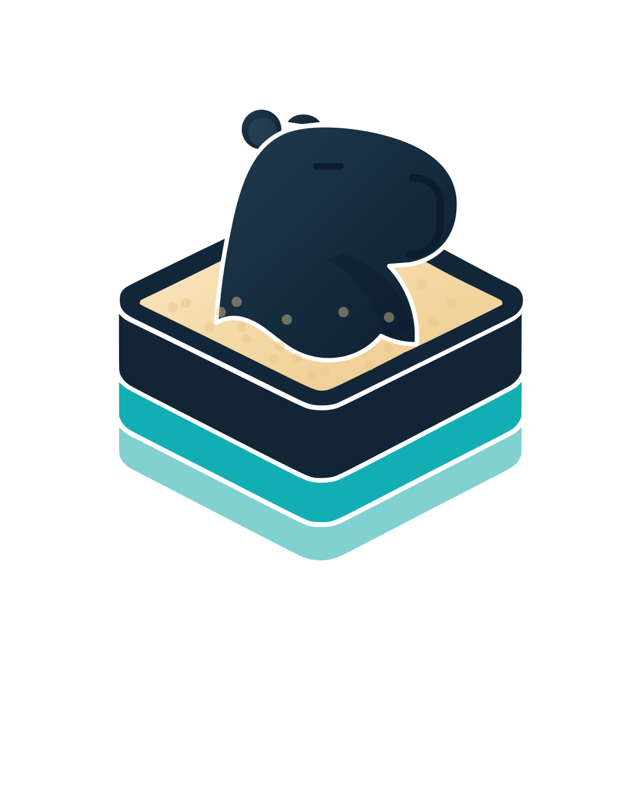

<div align="center">
  
</div>

# capy

**C**ontext-**A**ware **P**rompting ...or "**Y**et another solution to LLM context problem"

[](https://github.com/serpro69/capy/stargazers) [](https://github.com/serpro69/capy/network/members) [](https://github.com/serpro69/capy/commits) [](LICENSE.md)

capy helps coding agents work with large outputs without filling their context window. It is a local MCP server with integrations for Claude Code and Codex CLI, distributed as a Go binary.

- **Extract what matters.** Process logs, API responses, web pages, and large files in subprocesses; return summaries or search results to the agent.
- **Keep knowledge across sessions.** Index project documentation and notes, then retrieve relevant passages on demand.
- **Archive conversations.** Search, browse, and restore Claude Code and Codex sessions from an encrypted session vault.

Storage and search run locally, with mandatory database encryption and no telemetry, account, or hosted service. Fetches and submitted code can make network requests; results returned to your agent follow that agent's data policies.

## Contents

<!--toc:start-->
- [Quick Start](#quick-start)
- [Everyday Use](#everyday-use)
- [MCP Tools](#mcp-tools)
- [Session Vault](#session-vault)
- [Configuration](#configuration)
- [Encryption](#encryption)
- [Hooks and Permissions](#hooks-and-permissions)
- [Troubleshooting](#troubleshooting)
- [CLI Commands](#cli-commands)
- [Benchmarks](#benchmarks)
- [Contributing](#contributing)
- [Acknowledgements](#acknowledgements)
- [License](#license)
<!--toc:end-->

## Quick Start

### Install

**Homebrew** (macOS/Linux):

```bash
brew install serpro69/tap/capy
```

**Shell script** (Unix):

```bash
curl -sSfL https://raw.githubusercontent.com/serpro69/capy/master/install.sh | sh
```

Or [build from source](CONTRIBUTING.md#clone-and-build) with Go 1.27.2+ and a C compiler. Put the resulting `capy` binary on your `PATH`.

### Set an encryption key

The knowledge database requires a passphrase. For a **new database**, generate and save one:

```bash
export CAPY_DB_KEY=$(openssl rand -base64 48)
echo "export CAPY_DB_KEY='$CAPY_DB_KEY'" >> ~/.zshrc  # or ~/.bashrc
```

Keep this key: reuse it for an existing database instead of generating another. Generated passphrases of at least 32 characters are recommended. Start your agent from an environment that has the key. For separate project keys, use a [private credential file](#project-credentials).

### Setup (Claude Code)

Run from your project root:

```bash
capy setup --platform claude-code
capy doctor
```

Setup registers the MCP server and hooks, and adds routing instructions for the agent. Use `--local` to put Claude hooks in `.claude/settings.local.json`; otherwise setup offers the shared `.claude/settings.json` target. Restart Claude Code to load the configuration.

### Setup (Codex CLI)

Run from your project root with `capy` on your `PATH`:

```bash
capy setup --platform codex
capy doctor
```

Trust the project in Codex, then review and trust the generated definitions in `/hooks`. These are separate steps; setup does not change trust or enable explicitly disabled hooks. Restart Codex after changing its environment or installed configuration, and review changed hook definitions again.

Commit `.codex/hooks.json`, `.codex/config.toml`, and `.codex/capy-owner` together. The owner marker is an installation ID, not a secret; setup preserves it and existing external hooks. Every collaborator who enables these hooks needs a compatible capy on their own `PATH`. If you use `--binary`, it must identify that same executable.

Live integration has been checked with **Codex CLI 0.162.1 on Linux**. Other versions, operating systems, Codex surfaces, and automatic hook discovery outside Git projects remain unverified. Doctor checks configuration on disk, not trust or actual hook delivery. See [Codex hook recovery](#codex-hook-recovery) if calls are blocked by an installation failure.

Omit `--platform` to configure **both** platforms. The `--local` and `--project` flags select the Claude settings file only.

## Everyday Use

Once setup is active, use your agent normally. The routing instructions help it choose capy for large-output extraction. You can also ask explicitly:

> Use capy to find the most frequent errors in the application log, then show the relevant examples.

The agent can process the log with `capy_execute_file` and return only the counts and matching lines. For several commands, `capy_batch_execute` indexes their output and searches it in one call.

Use native tools when the agent needs the full content: reading a file before editing, reviewing a Git diff, or understanding a short issue description. capy is most useful when you need specific facts from a large body of data.

### Save and search project knowledge

You can use the same knowledge database from your terminal:

```bash
capy index docs --source project-docs --include '**/*.md'
capy search connection pooling
capy search timeout --source 'project-docs:' --limit 10
```

Indexing creates durable sources, one per file. Reusing a source label updates that source; it does not append another note. Give unrelated notes distinct labels. Directory scans respect Git ignores, skip common credential/build paths, and report incomplete scans. Removed or excluded files remain indexed until explicitly cleaned up.

Terminal `capy search` searches knowledge only. Use `capy vault search` for conversations, or the agent's `capy_search` tool for both. File refresh is bounded, so results can still contain cached content; see the [indexing and search reference](docs/reference/tools.md#file-and-directory-indexing) for filters, limits, and partial scans.

## MCP Tools

Your agent receives the argument schemas when it connects. The ten tools are:

| Tool | Purpose |
| --- | --- |
| `capy_execute` | Run code and return its printed output; use `intent` to retrieve relevant sections from large output. |
| `capy_execute_file` | Process a file through `FILE_CONTENT` without putting the raw file in context. |
| `capy_batch_execute` | Run several shell commands, index their output, and optionally search it. |
| `capy_index` | Save text, a file, or a directory as durable knowledge. |
| `capy_search` | Search project knowledge and archived conversations together. |
| `capy_vault_search` | Search archived conversations only, with project and date filters. |
| `capy_fetch_and_index` | Fetch a URL and index its content for extraction and follow-up searches. |
| `capy_stats` | Show context savings and usage statistics. |
| `capy_doctor` | Check the running server's configuration and available capabilities. |
| `capy_cleanup` | Preview or remove knowledge entries and reclaim storage. |

Execution supports JavaScript, TypeScript, Python, Shell, Ruby, Go, Rust, PHP, Perl, R, and Elixir, using runtimes installed on your machine. Commands run from the selected project by default; optional `cwd` changes the execution directory for that call. It does not change the database, credentials, or the base for an `execute_file` input path.

With `intent`, execution output over 5,000 bytes is indexed and searched instead of returned in full. Batch output is indexed whether or not queries are supplied. Capture and source-size limits still apply. See the [tool reference](docs/reference/tools.md) for background processes, argument validation, batch scope, and cleanup behavior.

### Finding earlier results

| Content | Retention | Included in default `capy_search`? |
| --- | --- | --- |
| Indexed notes and files (`durable`) | Retention-based cleanup | Yes |
| Command output and fetched pages (`ephemeral`) | 24 hours by default | No |
| Archived conversations (`session`) | Kept until explicitly deleted from the vault | Yes, with `CAPY_VAULT_KEY` |

To recover command output or fetched pages, use `include_kinds: ["durable", "ephemeral"]` or a `source` filter. Source filters match literal label substrings, include matching ephemeral knowledge, and skip vault search. Fetch reference material with `kind: "durable"` when it should persist across sessions.

MCP session searches default to the current project. Use `all_projects: true` or `project: "*"` to widen them. An explicit `project` matches a custom session project label, falling back to its imported path. Default scoping still uses the imported path: naming a worktree session does not associate it with a different checkout. These selectors affect sessions only.

Fetches reuse cached content for 24 hours by default. Use `force: true` or `ttl: 0` to fetch again; `ttl` is in milliseconds and controls freshness, separately from retention. Git issue/PR/MR URLs receive guidance to use the platform CLI, which is better suited to reading those discussions in full.

## Session Vault


The vault is an encrypted archive of Claude Code and Codex conversations across projects. It preserves transcripts and available sidecar files so you can search or restore them after the original files are deleted. You can use it independently of the MCP server.

### Setup and import

The vault requires its own key, separate from the knowledge key. For a **new vault**:

```bash
export CAPY_VAULT_KEY=$(openssl rand -base64 48)
echo "export CAPY_VAULT_KEY='$CAPY_VAULT_KEY'" >> ~/.zshrc  # or ~/.bashrc
```

Keep and reuse that key for the existing vault, then import and browse:

```bash
capy vault import
capy vault list --tui
capy vault search "rate limiter"
capy vault show 3f8a1c2b
```

Import scans the platform roots present on disk, honoring `CLAUDE_CONFIG_DIR` and `CODEX_HOME`. Use `--dry-run` to preview, `--platform claude-code` or `--platform codex` to restrict it, and `--source <dir>` for another location. Repeated imports skip unchanged sessions, update grown ones, and keep the larger archive when the local transcript is smaller.

With `CAPY_VAULT_KEY` in its launch environment, the MCP server also archives the current project's sessions at startup. Set `CAPY_VAULT_SWEEP_ALL=1` to scan all projects on startup. **Run `capy vault import` periodically** to capture sessions from projects you do not reopen; files deleted before import cannot be recovered by capy.

The default location is `~/.local/share/capy/vault.db` (under `XDG_DATA_HOME` when set). Override it with `CAPY_VAULT_PATH` or `capy vault --path <vault.db>`.

**Archives are verbatim.** Search snippets have recognized secrets redacted, but stored transcripts retain them, and restore writes plaintext files. The vault has no automatic expiry; `capy vault delete` removes an archive without deleting the original session files.

### Browse and find

Add `--tui` to `vault list`, `search`, or `show` for interactive browsing. Project and platform filters remain active inside the UI.

| Key | Action |
| --- | --- |
| `f` in the list | Filter by title, project, or UUID. |
| `]` / `[`, then `enter` in the viewer | Select and open a collapsed tool result or diff. |
| `/` in the viewer | Find exact, case-sensitive text; `n` / `N` move between matches. |
| `ctrl+f` in the viewer | Find a line with fuzzy matching. |
| `v` | Inspect the archived raw JSONL. |
| `e` (`ctrl+e` in search) | Rename a session. |
| `ctrl+g` | Change its project label. |
| `c` in the viewer | Copy the current message. |
| `r` / `R` | Restore / resume a session. |
| `esc` / `q` outside query editing | Esc clears active find before going back; `q` goes back immediately. |

Viewer search includes collapsed tool content; it does not search unopened child sessions. For styled Markdown in user and assistant messages, build with `make build-glamour`. The [vault reference](docs/reference/vault.md) covers advanced filters, exports, navigation, and environment variables.

#### Codex edits and executable inputs

Codex patches appear as expandable file-change groups with paths, counts, and diffs. Failed, declined, incomplete, and unconfirmed changes are labelled accordingly; archived evidence does not verify the current filesystem. Long executable inputs also collapse into markers and can be read or searched without executing them. Existing archives gain this presentation when reopened, without reimport or reindexing. See the [marker reference](docs/reference/vault.md#codex-edit-and-input-markers) for exact labels and their meaning.

### Restore and resume

Lookups accept an unambiguous session UUID prefix of at least eight characters; use the longer displayed ID if a prefix is ambiguous.

```bash
capy vault restore 3f8a1c2b
capy vault restore 3f8a1c2b --output /path/to/export
capy vault resume 3f8a1c2b
```

Restore writes the transcript and preserved sidecars to the platform's session directory, or to `--output`. Existing files require overwrite confirmation. `resume` restores and launches Claude Code; `--dir` overrides its working directory.

For **Codex**, run `capy vault restore <id>`, then `codex resume <full-uuid>` yourself. Automatic resume is not supported. Codex child sessions are archived separately and hidden from the list by default; use `--include-children` or `s` in the TUI to show them. Deleting a parent keeps its children. Codex revert variants are skipped with a warning.

### Names and project labels

```bash
capy vault rename 3f8a1c2b "Rate limiter investigation"
capy vault project 3f8a1c2b "capy"
capy vault list --name "rate limiter"
capy vault search "timeout" --project "capy"
```

Names and labels change vault metadata, leaving transcripts and restore locations intact. Use `rename <id> --clear` or `project <id> --clear` to reveal the imported title or path again. Names are independent of names in the original agent, and transcript search does not search words found only in a name or label.

### Maintenance and cross-machine sync

Use `capy vault stats` to inspect size and indexing status. After an upgrade, run `capy vault reindex` if doctor or stats reports a backlog; it rebuilds search from archived content.

To combine machines' archives, checkpoint the source with `capy vault checkpoint`, copy it to a **separate writable file** on the destination machine, then merge:

```bash
capy vault merge --from /path/to/copied-vault.db --dry-run
capy vault merge --from /path/to/copied-vault.db
```

If the source uses a different passphrase, provide it through `CAPY_VAULT_MERGE_KEY`. Merge adds missing sessions, keeps the larger transcript on overlap, and reconciles names and project labels independently using the latest edit or clear. Replacing the destination `vault.db` directly would lose archives found only there.

Upgrade all machines before sharing a vault containing Codex sessions: older capy versions without Codex support refuse to open it.

For key rotation, stop MCP and other processes using the vault, set `CAPY_VAULT_KEY` to the new passphrase, then run `capy vault rekey` and enter the old one when prompted. Persist the new key before restarting. The backup remains readable with the old key; `--remove-backup` deletes it after verification but does not guarantee secure erasure. `capy vault compact` can reclaim space from older uncompressed archives; stop MCP before running it.

## Configuration

Configuration is optional. Settings merge in this order, with later files taking precedence:

1. `~/.config/capy/config.toml` (under `XDG_CONFIG_HOME` when set)
2. `.capy/config.toml`
3. `.capy.toml`

Common settings, shown with defaults:

```toml
[store]
# path = ".capy/knowledge.db"  # optional override
# key_file = ".capy/db.key"   # optional private passphrase file
max_source_bytes = 2097152   # 2 MiB per source

[store.cleanup]
ephemeral_ttl_hours = 24

[store.cache]
fetch_ttl_hours = 24

[executor]
timeout = 30                # seconds
max_output_bytes = 102400    # 100 KiB captured output

[search]
window_ms = 60000
taper_after = 3
block_after = 8

[vault]
min_session_bytes = 0        # minimum size for new archives; 0 disables
```

Restart MCP after configuration changes. Invalid configuration stops knowledge access instead of silently choosing another database. See [all configuration defaults](docs/reference/operations.md#configuration-defaults) for less common settings.

The MCP `capy_search` budget is shared by all callers of one server. With defaults, calls 1–3 return at most two results per query, calls 4–8 at most one, and later calls are blocked until the 60-second window resets. Responses report remaining budget and reset time. Configure `1 <= taper_after < block_after <= 10000` and a `window_ms` of 1,000–3,600,000. Terminal search and `capy_vault_search` are unaffected.

`vault.min_session_bytes` filters new archives by uncompressed transcript plus sidecar size. Existing archives still update. Override it for an import or merge with `--min-size-bytes`; `0` disables an inherited limit.

### Database location and backups

The knowledge database defaults to `~/.local/share/capy/<project-hash>/knowledge.db` (under `XDG_DATA_HOME` when set). Run `capy which` to find it.

A relative `store.path`, such as `.capy/knowledge.db`, lets linked Git worktrees share the main checkout's database and credentials. Absolute paths and the XDG default do not use that sharing rule.

Before copying or committing a knowledge database, stop processes using it and run `capy checkpoint`. This flushes SQLite's pending writes into the main file; failure means the file is not ready to copy. Never pull or replace a database while a session is using it.

For Git-based sync, keep databases in a separate private repository to avoid growing your source repository with binary history. A symlink from the project's relative `store.path` keeps worktree sharing and portable configuration. Run `capy setup --db-repo` in the database repository to install a commit guard and ignore SQLite sidecars. The guard rejects unencrypted databases and databases with pending writes or open connections; it does not repair them or protect pulls. Checkpoint from the owning project, or use `capy checkpoint --project-dir <project>`. See the [setup and sync recipe](docs/reference/operations.md#knowledge-databases-in-a-separate-git-repository).

## Encryption

Both databases are encrypted at rest. The knowledge database uses the credential below; the vault always requires `CAPY_VAULT_KEY` in the actual launch environment. Keep keys private and backed up, and keep passphrases out of tracked configuration.

### Project credentials

To give a project its own key, put the passphrase in a private file such as `.capy/db.key`, set its permissions to `0600`, and add this to the project's TOML configuration (merge into an existing `[store]` section):

```toml
[store]
key_file = ".capy/db.key"
```

For an existing database, use its **existing passphrase**. The file contains only the literal passphrase, without assignment syntax or surrounding quotes. Spaces are preserved; one trailing LF or CRLF is removed. The file must be nonempty, at most 4,096 bytes including the newline, and contain no embedded line endings or NUL bytes. Regular files and symlinks to regular files are supported.

Permissions must be `0400` or `0600`. Project `capy setup` repairs broader permissions on an existing configured file's target without changing its contents; normal access rejects unsafe permissions. Setup ignores `.capy/**`; add your own ignore rule if you keep the key elsewhere.

Credential selection is:

1. Configured `store.key_file`.
2. `CAPY_DB_KEY` in the database owner's `.env`.
3. `CAPY_DB_KEY` in a distinct main-worktree `.env`.
4. Inherited `CAPY_DB_KEY`.

An invalid, inaccessible, or incorrect selected credential fails without trying another key. Relative key-file paths resolve from the database owner; with a relative `store.path`, that is the main checkout, so a linked worktree's own `.env` is ignored. Absolute/XDG database modes consult the selected worktree first. Paths do not expand `~` or environment variables, and a database symlink does not change credential ownership. Set `key_file = ""` to clear an inherited setting.

Dotenv files must be regular and no larger than 1 MiB. When one declares `CAPY_DB_KEY`, the entire file must contain only comments, blank lines, and supported single-line assignments, with optional `export`. Duplicate or empty key declarations fail. Unquoted values cannot contain whitespace, quotes, backslashes, expansion markers, or shell operators. Single quotes preserve literal bytes; double quotes support only escaped backslash and double quote, and reject dollar signs and backticks. Comments after unquoted values require separating whitespace. No shell code or variable expansion runs, and other variables are not exported. Use a key file if your application dotenv uses a richer syntax.

A running server retains its selected key until restart. `capy doctor` reports the selected credential source separately from whether it can open the database.

### Upgrade and credential migration

After upgrading capy, invoke the new binary directly to rerun setup for each installed platform and restart the agent/MCP processes. Preserve the existing Claude settings target (`--local` or `--project`). Check the [compatibility reference](docs/reference/operations.md#upgrades-and-compatibility) if scripts depend on earlier tool argument, permission, or execution behavior.

Before upgrading from wrappers that sourced `.env`:

- Move the existing knowledge passphrase to a key file if the application dotenv does not meet the format above.
- Put `CAPY_VAULT_KEY` in the environment of the process that launches MCP. A vault key stored only in `.env` no longer enables the vault; exporting it in another terminal does not update a running daemon.
- Ensure configured key files have supported permissions, using project setup or `chmod 600`.

Check actual knowledge reads with `capy_search` and vault status with `capy_doctor` through MCP. Terminal doctor cannot verify another process's environment.

For rollback, stop MCP, checkpoint with the current binary, and supply the same knowledge passphrase through the launch environment for versions without key-file support. Keep the vault key separate. Restore a matching binary and generated configuration, restart, and verify reads. Credential-file support itself does not require rewriting the database. See [Codex hook recovery](#codex-hook-recovery) before replacing Codex bindings.

### Initial encryption and key rotation

New databases are encrypted automatically. For a legacy unencrypted knowledge database, or to change an existing database's key, stop all processes using it, then:

```bash
export CAPY_DB_KEY='new-passphrase'
capy encrypt
```

Enter the old passphrase when prompted, or press Enter for an unencrypted database. The new key comes from `CAPY_DB_KEY`, or a confirmed prompt when unset. Project credential files supply neither input and are not rewritten: update them and persist the new key before restarting. The original database remains as `<path>.bak`: plaintext for initial encryption, or readable with the old key after rotation. This command does not rotate the vault key.

## Hooks and Permissions

Hooks guide large-output work toward capy and enforce additional command policies. They do not automatically capture or reduce the output of every native tool call.

- **Claude Code:** main-agent HTTP calls through Bash or WebFetch are redirected to capy or the platform CLI. Read/Grep guidance is advisory; subagents receive routing instructions.
- **Codex CLI:** native shell calls and capy tools are covered; hosted web/search tools are outside that coverage. Main-session HTTP routing is advisory until that session successfully uses `capy_execute`; that success allows one redirect within 60 seconds.
- **Subagents:** routing depends on their own recent successful capy use. Without evidence of an available tool, guidance permits native fallback. This does not grant permission or bypass security rules.
- **Downloads:** silent file downloads remain allowed by the HTTP routing rules, subject to permissions.

Capy reads additional Bash and Read rules from `.claude/settings.local.json`, `.claude/settings.json`, and `~/.claude/settings.json`, even for Codex. Denies win over allows. In Codex, a matched ask rule blocks with the rule and source named, because the hook cannot request approval. Codex's own sandbox and permission rules continue to apply independently.

Capy supports a subset of host permission syntax. Read denies protect explicit file indexing, `capy_execute_file`, and stale-file refresh. An external `execute_file` input needs an explicit Read allow covering both its requested and resolved paths, such as `Read(~/reports/**)` or `Read(//absolute/path/**)`; denies still win. Restart MCP after changing rules. Blocking a file read does not remove previously indexed content. See [permission examples and path syntax](docs/reference/operations.md#permission-rules).

Execution has timeouts, output limits, process-group cleanup, environment sanitization, and shell-command checks. Fetching blocks private-network and metadata endpoints. Knowledge indexing redacts recognized secret patterns. These checks are **not an OS sandbox for arbitrary code**: file-input checks do not govern every read inside submitted code, and pattern-based redaction cannot catch every secret.

## Troubleshooting

Run `capy doctor` from the project and `capy_doctor` through your agent to compare the terminal and running-server environments.

| Problem | Action |
| --- | --- |
| Hooks or MCP are not registered | Rerun `capy setup --platform claude-code` or `capy setup --platform codex` in the project, then restart the agent. |
| Codex setup cannot find a compatible binary | Install capy on `PATH`; `./capy setup` alone does not put it there. `--binary` must match the PATH executable. |
| Nested Codex setup fails | Upgrade capy on `PATH`; nested installations need distinct owner IDs. See [nested setup](#overlapping-codex-installations). |
| Knowledge credential is missing | Configure a private key file or supply `CAPY_DB_KEY` in the launch environment. |
| Wrong passphrase | Check doctor's selected credential source and restore the existing passphrase there. Restart MCP; do not delete the database. |
| Key-file permissions rejected | Run project setup or set the key file's target to `0600`. |
| Dotenv or TOML rejected | Fix the reported configuration error; use a key file for dotenv syntax capy does not support. |
| Vault is disabled | Supply `CAPY_VAULT_KEY` in the actual launch environment and restart the host/MCP. |
| Archived sessions are missing from search | Run `capy vault import`; if indexing is behind, run `capy vault reindex`. Check the search's project scope. |
| Search is temporarily blocked | Wait for the reset reported by `capy_search`; see [Configuration](#configuration). |
| FTS5 unavailable | Rebuild with `make build`, which includes the required `fts5` tag. |
| No execution runtimes found | Install the runtime the agent needs and make it available on the launcher's `PATH`. |

### Codex hook recovery

Trusted hooks can block matched calls when capy is missing, incompatible, or its installation configuration is invalid. Repair infrastructure failures from an **external terminal**: install the compatible binary, correct PATH or permissions, rerun `capy setup --platform codex`, and restart Codex. Individual capy entries can be disabled in `/hooks` during repair and reviewed/re-enabled afterward. A matched policy denial needs a policy change by its owner, not an installation workaround.

Restore a missing or corrupt `.codex/capy-owner` from committed configuration; do not generate a new ID for existing bindings.

Stop affected sessions before moving or removing loaded artifacts. On rollback, restore matching binary and configuration versions. Preserve external hooks and their metadata; keep the owner marker and compatible capy while any hook or MCP entry references them.

### Overlapping Codex installations

Parent and child projects can each have capy. Run `capy setup --platform codex --project-dir <project>` for each; use `--project-dir .` from a child inside the same Git repository to override Git-root discovery. Reruns preserve each installation's owner ID. A session opened in the child uses the child's capy rules, settings and knowledge database. Ancestor capy hooks do nothing there. A parent MCP command launched inside the child fails with a reload diagnostic instead of opening the wrong database. Global rules and unrelated hooks still apply.

Use setup to create a distinct `.codex/capy-owner` in each project; copying the parent's installation into the child produces ambiguous IDs and is rejected. All ancestor bindings must retain their matching markers, even across Git boundaries. Restart affected Codex sessions after setup and review/trust each project's generated definitions. Doctor checks registration, not activation.

Older capy versions reject all nested installations: upgrade the binary on `PATH` and rerun setup in the child without removing the parent. `--local` still targets both platforms; for Claude-only setup, use `capy setup --platform claude-code --local`. Successful Claude changes remain if the subsequent Codex setup fails.

To intentionally remove an installation, stop affected sessions, remove its capy hook entries (including inline hooks) and MCP registrations, then remove its owner marker. Preserve unrelated configuration. Deleting just the marker leaves broken bindings.

## CLI Commands

Use `capy <command> --help` for flags and examples.

| Command | Purpose |
| --- | --- |
| `capy` / `capy serve` | Start the MCP server over stdio. |
| `capy setup` | Configure project integrations. |
| `capy doctor` | Diagnose the installation. |
| `capy index <path>` | Index a file or directory as durable knowledge. |
| `capy search <query...>` | Search knowledge from the terminal. |
| `capy which` / `capy dbsize` | Show the knowledge database's path or disk usage. |
| `capy cleanup` | Preview cleanup; `--force` applies eviction. |
| `capy checkpoint` | Flush pending knowledge database writes before copying or committing. |
| `capy encrypt` | Encrypt a legacy knowledge database or rotate its key. |
| `capy vault <command>` | Import, browse, search, restore, and maintain conversation archives. |
| `capy completion <shell>` | Generate shell completions; Homebrew installs them automatically. |

Use `--project-dir <path>` to select another project. Other MCP clients can register `capy serve` as a stdio server; the automatic hook integrations cover Claude Code and Codex CLI.

## Benchmarks

The published suite uses 156 synthetic cases. It reports a relevant result in the top five for **98.7%** of cases, and **49.8%** context compression with **98.3%** recall of the specified facts. These measure retrieval and summary text, not an LLM's ability to answer correctly.

See [results and methodology](benchmark/RESULTS.md) for limitations and reproduction with `make bench-quality`, or the [cross-tool comparison](benchmark/COMPARISON.md).

## Contributing

See [CONTRIBUTING.md](CONTRIBUTING.md) for building, testing, and contribution guidelines, and [architecture](docs/architecture.md) for implementation details.

This project is developed with AI assistance and human review, testing, and rework.

## Acknowledgements

capy began as a Go port of [context-mode](https://github.com/mksglu/context-mode), which provided the original search, chunking, execution, and routing foundations. It has since evolved independently with persistent knowledge, mandatory encryption, and the session vault. Go provides a native binary without a Node.js installation requirement for capy itself.

## License

[Elastic License 2.0](LICENSE.md) (source-available).
