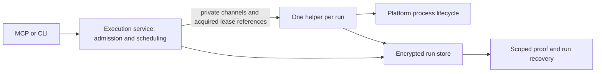

# Native macOS captured execution

> Status: design sections approved; implementation pending; native feasibility unproved
> Created: 2026-10-22
> Baseline: `44ceb813ce2d4f129d058f2534faa2a57b07d8bd`
> Plan: [implementation.md](implementation.md) · Work: [tasks.md](tasks.md)
> Evidence: [isolated verification](verification.md)
> Predecessor: [routine command capture](../../done/routine-command-capture/design.md)

## Outcome and scope

Restore native captured commands for agents and developers using Capy on Apple
Silicon. The current capture service rejects every non-Linux OS before spawn,
while Codex routing requires capture for recognized tests, builds, and installs.
The macOS release artifact and doctor checks do not expose that incompatibility
adequately.

The user selected **A: native process-group supervision with explicit macOS
cleanup limits**, after comparison with additional descendant tracking and a
Linux-equivalent-proof prerequisite. The user approved the scope/completion,
ownership/startup, recovery/compatibility, and verification/rollout sections.
Those approvals do not establish that the proposed native mechanisms work.

Success means CLI execute, MCP execute/file, yielded runs, and serial/parallel
batches execute once, capture into the same encrypted owner-local run store,
return bounded truthful results, and support recovery after restart. Darwin's
declared cleanup scope must be visible and durable. Linux keeps its existing
descendant retirement behavior. No platform may certify a stronger proof than
its backend establishes.

Apple Silicon is the first hardware target. **The minimum macOS version is an
open feasibility decision**, assigned to Task 1: choose and record the floor,
deployment target, native test versions, and matching API evidence before enabling
support. The local macOS 26.6.2 host is evidence of the research environment, not
a chosen support floor. Compilation and a `--version` smoke test are insufficient.

## Existing boundaries

| Component | Responsibility retained |
| --- | --- |
| `internal/execution` | Admission, owner scheduling, handoff, helper control, response bounds |
| `internal/executor` | Runtime preparation, compile/run phases, process and pipe lifecycle |
| `internal/runstore` | Encrypted capture/projection, leases, persisted proof, recovery, retention |
| `internal/server` and `cmd/capy` | MCP/CLI validation and transport adapters |
| `internal/hook` and `internal/platform` | Credential-free routing, registration, capability diagnostics |

Reuse capture queues, sanitization, quota, search, and runtime preparation.
Introduce platform-specific process/lease verification seams rather than a second
execution service or a new job daemon. Keep other unsupported OS/architecture
combinations explicit; a `darwin` build tag alone does not imply tested support.

## Ownership and startup

The service remains the logical owner. Its helper retains owner-slot and
lifecycle lease references until cleanup, capture finalization, and backend close.
The helper's private descriptors never reach executed commands. Credentials
remain on the bounded private channel, not argv, new environment variables, or
plaintext manifests. Owner EOF, cancellation, and deadlines retain their existing
control roles. A buffered start frame can race owner death; cleanup must handle
that race rather than claim spawning after owner death is impossible.

Linux retains its kernel-backed lock verification. Darwin's preferred candidate
is a **shared-offset identity exchange**, described and independently examined in
[Q2 follow-up](verification.md#q2-follow-up-can-shared-offsets-establish-descriptor-continuity).
Duplicated/inherited regular-file descriptions share offsets; independent opens
do not. Ordered changes observed on each process's own descriptor establish
identity without changing lock modes or file contents. Echoed tokens and matching
initial offsets are insufficient.

Identity is not lock acquisition. The launch boundary must consume a
`runstore`-controlled reference to the exact successfully acquired owner EX and
lifecycle SH descriptions. Generic arbitrary files cannot satisfy production
construction. Preserve acquisition provenance, no-unlock/no-conversion rules,
and continuous lifetime; retain file safety, inode/store/slot, generation, and
policy checks. This relies on cooperating Capy processes, not resistance to an
arbitrary same-user actor forging the private protocol.

Startup order is service admission → private identity exchange → helper store
authentication/binding → ready/start authorization → durable pending proof →
command spawn. The exchange must finish before inherited descriptors authorize
helper storage access. Use role/phase/exchange-bound messages and existing bounded
startup framing. Exchange failures cannot spawn a program.

Serialize exchanges across all aliases of either description, including parallel
batch launches. **Cancellation does not release that gate by itself.** A late
helper must be joined or conclusively unable to seek again before another exchange
uses the descriptions. Retain the gate and refuse further startup when necessary;
keep user-facing waits bounded without claiming the actor has stopped. Do not hold
the general service mutex while joining a helper. Normal running helpers no longer
touch offsets.

If this candidate fails its proof gate, do not silently substitute inode checks or
lock acquisition on incoming FDs. Return to the ownership decision. The verified
alternatives require helper acquisition or a genuine protected transfer and may
change topology; they are not pre-approved automatic fallbacks.

## Darwin process lifecycle and feasibility gate

Each compiler/runtime phase owns a dedicated command process group. The candidate
launches its leader in a new session, retains the direct child unreaped until the
last group signal, validates terminal wait status, and drains both output pipes.
No cancellation/recovery operation signals a PID loaded from persisted metadata.

Source verification found that kqueue registration `ESRCH` and `NOTE_EXIT` do not
prove immediate waitability. The bounded waiting path must validate actual
terminal state and handle the historical Darwin stopped-child caveat; do not
blindly reuse `wait_darwin.go` followed by a presumed-immediate `cmd.Wait`.

**The retirement certificate remains unresolved.** A retained terminal leader
and a complete group enumeration containing only that leader are a candidate,
not a proven algorithm. Task 1 must resolve in-progress fork/spawn publication,
group changes/re-entry, enumeration failures, and the interval before reaping.
Repeated observations alone are not proof of atomicity. Any chosen API must be
verified for the declared OS range, including availability and private/deprecated
status. A source argument and native adversarial fixtures are both required.

Descendants leaving the original group are outside A's cleanup promise. Their
possible later re-entry must still be addressed in the precise certificate and
scope definition. Do not redefine the scope retrospectively to hide an observed
failure. Source verification does not establish a native public subreaper
equivalent for this deployment.

Successful signalling, leader exit, and output EOF establish different facts.
A child may close output and remain alive. Conversely, an escaped child may hold
an output pipe open: the drain deadline then prevents complete-capture claims.
Closing a reader to bound cleanup does not manufacture EOF or complete output.

If bounded observation or cleanup cannot establish the approved certificate,
report unverified cleanup. If the certificate cannot be justified for ordinary
workloads, stop the backend integration and revise the design explicitly. The
feature is not complete merely because the implementation consistently refuses
macOS execution.

## Persisted proof and completion

Record an immutable backend-selected scope for every admitted run:

- `linux_descendants_v1`: the existing supervisor-owned descendant/pipe proof.
- `darwin_process_group_v1`: the approved group/pipe certificate, only after Task 1.

Retain the persisted states `not_spawned`, `pending`, and `retired`; interpret them
only together with a known scope. A typed proof must cross executor, helper IPC,
store completion, and response boundaries. An internal retirement boolean may be
retained only inside a mandatory scoped/versioned representation; it must never
be accepted as an unqualified portable proof. Missing, unknown, or mismatched
scope is an error, not an inferred Linux or Darwin default for new data.

| Observation | Completion/recovery consequence |
| --- | --- |
| Never spawned | Preserve known not-spawned state; no process retirement needed |
| Applicable retirement proved and output fully drained | May finish normally; complete capture additionally requires all observed bytes persisted |
| Capture fails after spawn | Continue execution/draining; preserve committed prefix and actual exit status |
| Applicable retirement unproved | Interrupted/incomplete result; pending proof; retain quarantine and evidence |
| Helper notification lost | Consult durable scoped proof; a free lease alone is insufficient |
| Helper killed with possible live execution | Keep pending proof and quarantine, even after all inherited locks disappear |

Preserve actual exit/signal information even when the overall run is interrupted.
Keep local retirement, durable acknowledgement, and output completeness distinct.
`capture.terminal_persisted` and read-page EOF are not independent cleanup proof.
Redaction and search-index availability remain separately reported; do not
reinterpret a projection/index failure as missing raw bytes or successful cleanup.

Recovery, admission/slot reuse, TTL/quota eviction, and batch aggregation must
validate scope before accepting retired evidence. Verified Darwin group scope is
accepted for normal reuse under the explicitly narrower contract; it does not
claim detached descendants have stopped. Unverified work must not age out as safe
history. Reset remains explicit discard under exclusive lifecycle ownership and
operator quiescence where required; it does not discover or terminate descendants.

## Compatibility and upgrade

Plan a run schema upgrade **8 → 9** and private helper protocol **1 → 2**; rebase
those numbers if upstream changes them before implementation. Persist scope as
authoritative row metadata with supported-value validation. New admission cannot
choose a scope from user input. Version-8 rows originated in the Linux-only path
and receive the existing Linux scope; preserve every prior state, including
pending cleanup and quarantine.

Upgrade only on normal execution-owner attachment, with successful selected-key
authentication and exclusive lifecycle ownership. Release shared handles before
requesting exclusivity; revalidate identity/version after acquisition. Perform
the supported upgrade transactionally, update the policy schema marker consistently,
and close DB handles before releasing the lease. Reattach and revalidate afterward.
Busy owners/readers require stop/reload; failure or unknown versions must not
trigger recreation, reset, or log deletion. Supervisor attachment never migrates.

Preserve store/run/batch IDs, raw/projection/index content, counters, timestamps,
and valid cursor positions. Include any new metadata charge in quota accounting;
if preservation cannot fit safely, fail actionably rather than evict logs merely
to complete an upgrade. Migration is not cleanup reconciliation: unknown evidence
remains unknown. Wrong keys produce no migration side effects. Read-only doctor
reports upgrade requirements without mutating the cache. Standalone recovery
queries report an upgrade requirement until a normal owner performs the upgrade.

Public run/result envelopes become **version 2**, exposing cleanup scope/state
as essential bounded metadata. Apply the version consistently to run, batch,
status/list, and associated recovery query envelopes; cursor format versions and
redaction versions remain unchanged when their representations are unchanged.
Historical stored response blobs are normalized from authoritative row metadata
at the read boundary, not trusted as a competing proof source.

Hooks explicitly accept supported v1 and v2 healthy envelopes. V1 retains its
Linux-era interpretation; v2 requires valid scoped state consistent with running
or terminal status. Unknown/malformed versions or scopes never create execution
availability evidence or fall back to parsing arbitrary output text. Preserve
security-before-routing and one-use observation rules. Older binaries reject the
new store; no automatic downgrade or run-log discard is introduced.

## Capability, verification, and rollout

Doctor reports compiled/OS execution capability separately from storage health
and hook activation. It does not run proof probes, open new run stores, claim
owners, or imply runtime writability. Setup/routing descriptions must be truthful
without changing trust, security policy, or silently disabling capture enforcement.
Synchronize generators and committed artifacts whenever their output changes.

Release acceptance requires native Apple Silicon execution for the declared
version matrix, Linux regression coverage, real helper re-exec, owner/helper
death and delayed-cleanup races, migration preservation, all public execution
paths, and bounded responses. Include the `integration`-tagged supervisor suites
explicitly: the ordinary FTS5 suite does not select all of them. Use synthetic
keys and isolated roots. Executor changes require the repository's quality and
performance comparisons; distinguish comparable Linux baselines from new Darwin
capture measurements.

The implementation plan defines a temporary operator-authorized test route while
the installed macOS capture path rejects commands. Do not bypass routing, rely on
a missing tool as permission, or treat design approval as a configuration change.
No test exception was applied during this design session.

## Assumptions

1. A defensible bounded group-retirement certificate exists for the declared native
   OS range. **Unproved; Task 1 is a blocking feasibility gate.**
2. Shared offsets provide usable identity evidence when trusted acquisition,
   exclusive offset access, continuous references, and cancellation-safe gate
   lifetime all hold. **Source-supported; native proof is Task 2.**
3. Current lease offsets are otherwise unused. Inspection found no seek users in
   execution/runstore; enforce this as an ownership invariant and test it.
4. Version-8 run rows represent the existing Linux scope. Validate actual baseline
   schema/provenance and unknown-version rejection before migration.
5. Native CI can exercise the chosen Apple Silicon OS floor. Record unavailable
   infrastructure as missing release evidence, not successful validation.

## Not Doing

- Intel support in the first release: user selected Apple Silicon first.
- Complete detached-descendant cleanup on Darwin: outside selected A; group
  retirement itself remains required, not deferred.
- Best-effort descendant tracking: adds observation complexity without the chosen
  proof; no optional tracker is part of this implementation.
- VM execution, persistent services, privileged helpers, restricted entitlements:
  different deployment/ownership products, unnecessary to the selected direction.
- Windows/BSD support, new runtime languages, PTY/stdin, persistent jobs, and
  cross-owner cancellation: independent execution features.
- Knowledge/vault migration, new retrieval algorithms, run rekey, automatic
  discard/downgrade, or security/trust changes: preserve existing contracts.

## Rejected alternatives

| Alternative | Reason |
| --- | --- |
| B: recursive best-effort descendant tracking | Can miss ancestry and introduces identity/timing complexity without full ownership proof. |
| C: require Linux-equivalent cleanup before any macOS support | No verified ordinary-CLI mechanism; would keep the core workflow unavailable for an uncertain investigation. |
| Delete the OS guard and reuse unqualified `retired` | Does not supply missing mechanisms and misrepresents recovery safety. |
| Use inode equality as lock proof | Establishes the file, not the locked open-file description. |
| Change incoming lock modes to test them | Acquisition/conversion is not passive verification and can create a protection gap. |
| Treat kqueue fork flags or launchd as a subreaper | Their verified contracts do not establish the needed descendant ownership. |
| Adopt the newer ES descendant client now | macOS 27/restricted-entitlement deployment; observation is not a verified retirement primitive. |

The offset exchange is a selected candidate, not a verified replacement for every
possible ownership check. Failed feasibility returns to design review; it does
not authorize adopting a rejected alternative silently.
