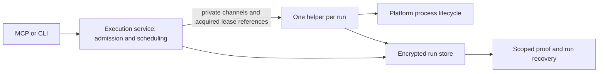

# Native macOS captured execution

> Status: observational Darwin cleanup approved 2026-10-22; implementation in progress; lease proof remains required
> Created: 2026-10-22
> Baseline: `44ceb813ce2d4f129d058f2534faa2a57b07d8bd`
> Plan: [implementation.md](implementation.md) · Work: [tasks.md](tasks.md)
> Evidence: [native process verification](process-proof.md) · [source verification](verification.md)
> Contract: [contracts.md](contracts.md)
> Predecessor: [routine command capture](../../done/routine-command-capture/design.md)

## Outcome and scope

Restore native captured commands for agents and developers using Capy on Apple
Silicon. The current capture service rejects every non-Linux OS before spawn,
while Codex routing requires capture for recognized tests, builds, and installs.
The macOS release artifact and doctor checks do not expose that incompatibility
adequately.

The user selected **A: native process-group supervision with explicit macOS
cleanup limits**, after comparison with additional descendant tracking and a
Linux-equivalent-proof prerequisite. The user approved the scope/completion,
ownership/startup, recovery/compatibility, and verification/rollout sections.
Those approvals do not establish that the proposed native mechanisms work.
After Task 2's deterministic native fixture reproduced group re-entry, the user
accepted the recommendation to adopt **observational process-group cleanup**:
“Agree. Let's do that.” This 2026-10-22 decision supersedes the requirement to
prove Darwin group retirement. It explicitly accepts that an undetected racing
process can survive successful cleanup observations and normal run reuse.
The native counterexample and earlier reviews remain evidence, not blockers
under a renamed retirement gate. Linux retirement and lease ownership guarantees
are unchanged.

Success means CLI execute, MCP execute/file, yielded runs, and serial/parallel
batches execute once, capture into the same encrypted owner-local run store,
return bounded truthful results, and support recovery after restart. Darwin's
declared cleanup scope must be visible and durable. Linux keeps its existing
descendant retirement behavior. Darwin reports completion of a bounded observation
policy, never certified group retirement. No platform may claim stronger evidence
than its backend establishes.

The initial target is **macOS 26 on Apple Silicon**, with deployment target
**26.0** and the explicit stable GitHub-hosted arm64 label **`macos-26`**.
On 2026-10-22 the user accepted this narrower scope and rejected blocking the
feature on older compatibility promises. The implementer's earlier macOS 15
candidate is superseded; older majors are outside this release's support contract.

Task 1 records actual API/toolchain and native waiter evidence for this single
major. Record the OS/kernel/SDK builds used; a proposed hosted SDK is future CI
configuration, not a separate compatibility gate. Task 12 adds hosted CI and
release-artifact checks. `macos-latest` alone does not define the target, and
self-hosted runner provisioning remains out of scope. See
[GitHub's runner reference](https://docs.github.com/en/actions/reference/runners/github-hosted-runners).
The local macOS 26.6.2 runtime fixtures provide native evidence for this target;
compilation and a `--version` smoke test alone are insufficient.

## Existing boundaries

| Component | Responsibility retained |
| --- | --- |
| `internal/execution` | Admission, owner scheduling, handoff, helper control, response bounds |
| `internal/executor` | Runtime preparation, compile/run phases, process and pipe lifecycle |
| `internal/runstore` | Encrypted capture/projection, leases, persisted proof, recovery, retention |
| `internal/server` and `cmd/capy` | MCP/CLI validation and transport adapters |
| `internal/hook` and `internal/platform` | Credential-free routing, registration, capability diagnostics |

Reuse capture queues, sanitization, quota, search, and runtime preparation.
Introduce platform-specific process/lease verification seams rather than a second
execution service or a new job daemon. Keep other unsupported OS/architecture
combinations explicit; a `darwin` build tag alone does not imply tested support.

## Ownership and startup

The service remains the logical owner. Its helper retains owner-slot and
lifecycle lease references until cleanup, capture finalization, and backend close.
The helper's private descriptors never reach executed commands. Credentials
remain on the bounded private channel, not argv, new environment variables, or
plaintext manifests. Owner EOF, cancellation, and deadlines retain their existing
control roles. A buffered start frame can race owner death; cleanup must handle
that race rather than claim spawning after owner death is impossible.

**Linux and Darwin both perform the same shared-offset identity exchange.**
Linux retains its additional kernel-backed fdinfo lock validation before the
exchange; there is one protocol-v2 message sequence, not platform-negotiated
shortcuts. Portable fixture coverage runs on Linux as well as Darwin. Linux's
descendant cleanup algorithm remains unchanged; new startup failure/latency paths
still require regression checks and measurement. The exchange is examined in
[Q2 follow-up](verification.md#q2-follow-up-can-shared-offsets-establish-descriptor-continuity).
Duplicated/inherited regular-file descriptions share offsets; independent opens
do not. Ordered changes observed on each process's own descriptor establish
identity without changing lock modes or file contents. Echoed tokens and matching
initial offsets are insufficient.

Identity is not lock acquisition. The launch boundary must consume a
`runstore`-controlled reference to the exact successfully acquired owner EX and
lifecycle SH descriptions. Generic arbitrary files cannot satisfy production
construction. Preserve acquisition provenance, no-unlock/no-conversion rules,
and continuous lifetime; retain file safety, inode/store/slot, generation, and
policy checks. This relies on cooperating Capy processes, not resistance to an
arbitrary same-user actor forging the private protocol.

Startup order is service admission → private identity exchange → helper store
authentication/binding → ready/start authorization → durable pending proof →
command spawn. The exchange must finish before inherited descriptors authorize
helper storage access. Use role/phase/exchange-bound messages and existing bounded
startup framing. Exchange failures cannot spawn a program.

Serialize exchanges across all aliases of either description, including parallel
batch launches. Gate acquisition precedes helper creation and consumes the same
bounded startup deadline, including any earlier execution deadline. A timeout
waiting for the gate leaves known-not-spawned work, not a stranded helper.
On failure **before any start-frame write attempt**, disable
authorization, SIGKILL the retained direct helper, and reap it before releasing
the gate. A three-second teardown observation budget is separate from startup;
an ordinary SIGSTOPped helper must recover without restarting the owner.
Cancellation and the first start write share an atomic phase boundary; partial
writes count as possible authorization. After that boundary, preserve cooperative
cleanup and durable-proof handling rather than kill the helper as a shortcut.

SIGKILL does not guarantee a bounded reap. If teardown cannot confirm death in
budget, retain the actor/gate/leases under cleanup tracking and refuse affected
owner startup until safe, even in this pre-start case. Do not abandon a waiter,
release a gate on signal delivery alone, or hold the general service mutex while
joining. Normal running helpers no longer touch offsets. The precise fields,
one-time gate release (including cancellation after ready),
sequence, and race boundary are in [the protocol contract](contracts.md#private-protocol-v2)
and [pre-start teardown](contracts.md#pre-start-teardown).

If this candidate fails its proof gate, do not silently substitute inode checks or
lock acquisition on incoming FDs. Return to the ownership decision. The verified
alternatives require helper acquisition or a genuine protected transfer and may
change topology; they are not pre-approved automatic fallbacks.

## Darwin process lifecycle and observational cleanup

Each compiler/runtime phase owns a dedicated command process group. The candidate
launches its leader in a new session, retains the direct child unreaped until the
last group signal, validates terminal wait status, and drains both output pipes.
No cancellation/recovery operation signals a PID loaded from persisted metadata.

Source verification found that kqueue registration `ESRCH` and `NOTE_EXIT` do not
prove immediate waitability. The bounded waiting path must validate actual
terminal state and handle the historical Darwin stopped-child caveat; do not
blindly reuse `wait_darwin.go` followed by a presumed-immediate `cmd.Wait`.

The accepted scope is `darwin_process_group_observation_v1`, with successful
state **`observed`**. It records the following facts for every spawned phase:

1. The direct leader reached a validated terminal state and was reaped exactly
   once. Its actual exit/signal status is retained even if cleanup fails.
2. Required group cancellation/cleanup signals completed without an unexplained
   error while the leader's identity was still retained. Group signals are never
   sent after reaping, nor from persisted PID/PGID metadata.
3. Both output pipes reached natural EOF. Closing readers to meet a deadline is
   a drain failure, not EOF. Capture persistence remains a separate condition.
4. After drainage and before the sole reap, a successful bounded group inventory
   contains the retained terminal leader and no other members. Missing leader,
   malformed/truncated inventory, observation errors, or remaining members at
   deadline prevent `observed`.

These are observations at named points, not proof that membership cannot change.
An in-flight fork/spawn or group join, a descendant that departed/re-enters, or an
escaped descendant can survive after `observed`. A survivor can continue writing
files, hold a port or consume resources. The user explicitly accepts normal reuse
and retention under this limitation; it is not an estimate that the races are rare.
The observed result never implies termination of every descendant or group member.

On cancellation/deadline/owner loss, attempt group termination immediately; on
natural leader exit, attempt cleanup of observed remaining live group members.
Allow at most three seconds for cleanup observation and natural drainage after
the first cancellation or terminal leader observation. Already-terminal members
need no additional signal, but must disappear from the final inventory. When
only the terminal leader remains, do not send a gratuitous signal to zombies.
Any required signal error remains incomplete; do not treat a permission error
as success. A deadline bounds userspace polling and response work, not arbitrary
kernel scheduling/I/O. Join every drain worker after closing readers on failure;
never abandon a wait goroutine. If leader terminal state cannot be established,
do not call an assumed-immediate blocking reap or certify cleanup.

**Task 11 implementation note:** each phase sends at most one successful group
SIGKILL, then continues observing within the same budget. Re-signalling a group
whose members are exiting produced an `EPERM` failure in native fixtures; that
error cannot be ignored under this contract. The single-signal implementation
deliberately reduces termination effort: a member joining after that signal
receives no further termination attempt. If it remains visible, cleanup stays
pending and the owner is quarantined. This availability tradeoff never permits
`observed` with a visible survivor or relaxes the final inventory, natural EOF,
required-signal error or sole-reap conditions.

Task 2 must verify these observable conditions on macOS 26 arm64, including the
actual error paths. It no longer needs to rule out unpublished membership or
in-flight joins. Keep the native re-entry fixture: its passing counterexample must
remain compatible with an honestly labelled `observed` result, never `retired`.

### Observation API

Use the documented read-only `sysctl` MIB
`CTL_KERN / KERN_PROC / KERN_PROC_PGRP / pgid`, through the SDK's
`struct kinfo_proc`, for the production inventory candidate. Apple's
[sysctl manual](https://developer.apple.com/library/archive/documentation/System/Conceptual/ManPages_iPhoneOS/man3/sysctl.3.html)
documents this selector and partial-buffer `ENOMEM` behavior; the local SDK 27.0
declares it without an API deprecation annotation. A comment deprecating XNU's
old internal sysctl dispatch file is not itself a userland API deprecation.
Verify the actual MIB on the target host before accepting the backend.

Bound allocation to 4096 entries, grow a short initial buffer only within that
cap/deadline, and reject partial/error/malformed responses rather than sampling
or silently truncating. Validate positive PID, requested PGID, and the retained
leader's presence. The inventory is diagnostic evidence of visible membership,
not an atomic closure guarantee, even when the API describes a consistent
snapshot. The fixture's private `libproc.h` binding remains test-only; no private
API fallback or shelling out to `ps` is selected for production.

### Evidence standard

For each matrix version, record either **source-aligned** evidence (relevant
published implementation matched to that version, documented API contracts, and
native fixtures) or **contract-backed** evidence (documented guarantees covering
the required observations plus native fixtures, with unmatched/missing sources
explicitly recorded as weaker evidence). Exact source availability is not a
universal prerequisite. Neither grade may infer unpublished kernel behavior from
a passing stress test. The observed policy still requires real leader ownership,
bounded waits, error handling and natural drainage; it does not require proving
fork-publication atomicity or preventing future re-entry. Earlier retirement
claims and failed candidates are retained in `process-proof.md` as historical
evidence under the superseded contract.

Descendants leaving the original group are outside the termination coverage;
later re-entry is an explicit limitation even if the process is back in the group
after the final observation. This is the accepted contract change, not a hidden
exclusion applied retrospectively to a failed test. Source verification does not
establish a native public subreaper equivalent for this deployment.

Successful signalling, leader exit, and output EOF establish different facts.
A child may close output and remain alive. Conversely, an escaped child may hold
an output pipe open: the drain deadline then prevents complete-capture claims.
Closing a reader to bound cleanup does not manufacture EOF or complete output.

If the selected observations cannot complete within budget, report incomplete
cleanup and keep it pending. A visible survivor prevents successful observation
until it disappears within the budget; a known error cannot be waved away as
the inherent race limitation. The feature is not complete if ordinary native
workloads only exercise rejection paths.

## Persisted cleanup evidence and completion

Record an immutable backend-selected scope for every admitted run:

- `linux_descendants_v1`: the existing supervisor-owned descendant/pipe proof.
- `darwin_process_group_observation_v1`: the bounded group/pipe observation policy above.

Use the persisted states `not_spawned`, `pending`, `retired`, and `observed`;
interpret them only together with a known scope. `retired` is Linux-only and
`observed` is Darwin-only; reject cross-scope pairs at SQL and typed boundaries.
`executor.CleanupEvidence` (`Scope`, `State`)
crosses executor, helper IPC, store completion, and response boundaries. Remove
the unqualified wire `Retired` flag in protocol v2; private convenience predicates
must inspect this typed evidence. Missing, unknown, or mismatched
scope is an error, not an inferred Linux or Darwin default for new data.
Combine compiler/runtime phase proofs over the entire run; a later unstarted
phase cannot erase an earlier spawned-and-completed phase. See the
[whole-run and snapshot rules](contracts.md#storage-and-typed-evidence).

| Observation | Completion/recovery consequence |
| --- | --- |
| Never spawned | Preserve known not-spawned state; no process retirement needed |
| Linux retirement proved or Darwin observation policy completed, with output fully drained | May finish normally under that scope; complete capture additionally requires all observed bytes persisted |
| Capture fails after spawn | Continue execution/draining; preserve committed prefix and actual exit status |
| Required cleanup observations/proof failed or timed out | Interrupted/incomplete result; pending evidence; retain quarantine and logs |
| Darwin `observed` with inherent creation/re-entry uncertainty | Permit normal reuse/retention; do not call it retirement or quarantine solely for the explicitly accepted limitation |
| Helper notification lost | Consult durable scoped proof; a free lease alone is insufficient |
| Helper killed with possible live execution | Keep pending proof and quarantine, even after all inherited locks disappear |

Preserve actual exit/signal information even when the overall run is interrupted.
Keep local cleanup evidence, durable acknowledgement, and output completeness distinct.
`capture.terminal_persisted` and read-page EOF are not independent cleanup proof.
Redaction and search-index availability remain separately reported; do not
reinterpret a projection/index failure as missing raw bytes or successful cleanup.

Recovery, admission/slot reuse, TTL/quota eviction, and batch aggregation must
validate scope and state together. Normal reuse/expiry accepts `not_spawned`,
Linux `retired`, or Darwin `observed`, with the existing completed-outcome and
lease/lifecycle conditions. This is policy acceptance, not a universal safety
predicate. `pending`, invalid and inconsistent evidence cannot age out as
completed history. Reset remains explicit discard under exclusive lifecycle
ownership and operator quiescence where required; it does not discover or
terminate descendants. An `observed` result is never proof of host quiescence
for moving/deleting files or other operations that require all processes gone.

### Contract summary

The normative [contract](contracts.md) fixes these decisions before implementation:

| Boundary | Representation |
| --- | --- |
| SQL | `runs.cleanup_scope TEXT NOT NULL`, no DEFAULT, CHECK limited to the two scopes above; `runs.cleanup` stores four states with valid scope/state pairing. |
| Public run v2 | Required `cleanup: {scope: string, state: string}` alongside `capture`; null only for a rejection without an admitted run. |
| Recovery views | Run/batch objects carry cleanup; lists use `entries[].cleanup`; search uses the selected subject's cleanup. Exact placement and aggregation are specified in the contract. |
| Helper v2 | Startup adds `exchange_id` and `cleanup_scope`; later frames bind the exchange; terminal proof is `outcome.result.cleanup`. |

[V1/v2 examples and hook rules](contracts.md#public-version-2-envelopes) and
[all protocol frame fields](contracts.md#private-protocol-v2) are authoritative.
Batch proof copies survive child-log eviction; the contract also fixes their
transactional synchronization and legacy migration interpretation.

## Compatibility and upgrade

Plan a run schema upgrade **8 → 9** and private helper protocol **1 → 2**; rebase
those numbers if upstream changes them before implementation. Persist scope as
authoritative row metadata with supported-value validation and **no column DEFAULT**.
New admission cannot
choose a scope from user input. Version-8 rows originated in the Linux-only path
and receive the existing Linux scope; preserve every prior state, including
pending cleanup and quarantine.

The pinned SQLite is 3.51.2. Its ADD COLUMN NOT NULL route requires a non-null
default; leaving that default would silently classify omitted new scopes as
Linux. Use the [contract's transactional table rebuild](contracts.md#upgrade-representation)
with an explicit Linux value only in the old-row copy. Both fresh and upgraded
tables must reject omitted, null, and unknown scope at SQL. Preserve foreign keys,
indexes, batch proof copies, and logical accounting. Allow for transient encrypted
table-copy/WAL disk headroom separately from retained-data quota; do not charge a
second permanent copy of each log. A space failure must roll back, not evict logs
to complete migration. [SQLite's ALTER TABLE rules](https://www.sqlite.org/lang_altertable.html).

Upgrade only on normal execution-owner attachment, with successful selected-key
authentication and exclusive lifecycle ownership. Release shared handles before
requesting exclusivity; revalidate identity/version after acquisition. Perform
the supported upgrade transactionally, update the policy schema marker consistently,
and close DB handles before releasing the lease. Reattach and revalidate afterward.
Busy owners/readers require stop/reload; failure or unknown versions must not
trigger recreation, reset, or log deletion. Supervisor attachment never migrates.

Preserve store/run/batch IDs, raw/projection/index content, counters, timestamps,
and valid cursor positions. Include any new metadata charge in quota accounting;
if preservation cannot fit safely, fail actionably rather than evict logs merely
to complete an upgrade. Migration is not cleanup reconciliation: unknown evidence
remains unknown. Wrong keys produce no migration side effects. Read-only doctor
reports upgrade requirements without mutating the cache. Standalone recovery
queries report an upgrade requirement until a normal owner performs the upgrade.

Public run/result envelopes become **version 2**, exposing cleanup scope/state
as essential bounded metadata. Apply the version consistently to run, batch,
status/list, and associated recovery query envelopes; cursor format versions and
redaction versions remain unchanged when their representations are unchanged.
Historical stored response blobs are normalized from authoritative row metadata
at the read boundary, not trusted as a competing proof source.

Hooks explicitly accept supported v1 and v2 healthy envelopes. V1 retains its
Linux-era interpretation; v2 requires valid scoped state consistent with running
or terminal status. Unknown/malformed versions or scopes never create execution
availability evidence or fall back to parsing arbitrary output text. Preserve
security-before-routing and one-use observation rules. Older binaries reject the
new store; no automatic downgrade or run-log discard is introduced.

### Rollback and mixed versions

To resume execution with a schema-8 binary after upgrade: retain the compatible
new binary long enough to export any required logs, stop every affected session,
owner, reader, and helper, and establish quiescence of old command groups where
cleanup was unverified. Then explicitly run `capy runs reset --discard` with the
selected owner using the compatible binary. Only after successful reset install
the older binary and its matching generated bindings, align CLI/PATH/plugin/MCP
versions, and restart. The old owner creates its old-format cache on next supported
execution. Keeping v9 logs requires keeping a compatible reader; there is no
in-place reverse migration. Downgrading also restores the old macOS execution
limitation, so it does not repair capture on this Mac.

Discard permanently removes **all retained run/batch logs for that owner**.
Twenty-four hours is a configurable default, not a maximum loss bound; protected
unverified evidence can be older. This workflow is an explicit operator choice,
not an automatic repair. Knowledge/vault storage and permanent locks are preserved.

A mixed old executable may currently emit the misleading generic
`storage_unavailable` advice about path/permissions because its schema comparison
does not distinguish versions. Document that symptom and use the new binary's
read-only doctor to identify the authenticated stored version and supported range.
New code returns an actionable version mismatch without suggesting chmod/reset
as an automatic fix. Do not add a plaintext sidecar marker: old binaries would
not read it, and it would add a stale-state/reset surface without fixing their error.

## Capability, verification, and rollout

Doctor reports compiled/OS execution capability separately from storage health
and hook activation. It does not run proof probes, open new run stores, claim
owners, or imply runtime writability. Setup/routing descriptions must be truthful
without changing trust, security policy, or silently disabling capture enforcement.
Synchronize generators and committed artifacts whenever their output changes.

Release acceptance requires native Apple Silicon execution for the declared
version matrix, Linux regression coverage, real helper re-exec, owner/helper
death and delayed-cleanup races, migration preservation, all public execution
paths, and bounded responses. **Add Linux integration coverage**, in addition to
retaining the existing Linux FTS5/race checks: today's CI and Makefile do not select
the three `linux && integration` execution suites. Add reproducible
`make test-integration` and `make test-integration-race` targets and invoke them
in Linux and native Apple Silicon CI. Baseline the newly activated Linux suites
against the pre-feature revision, retain failures, and budget fixture repairs as
explicit work; never make a new gate green by dropping integration tags or
weakening assertions. Use synthetic
keys and isolated roots. Executor changes require the repository's quality and
performance comparisons; distinguish comparable Linux baselines from new Darwin
capture measurements.

The implementation plan defines a temporary operator-authorized test route **for
Codex hosts enforcing routine capture** while macOS capture rejects commands.
Claude's routine routing is guidance-only; ordinary terminals and CI without that
hook need no Capy routine exception. Other security/sandbox controls still apply.
The exact configuration shape, approver, scope, expiry/removal, and verification
record are defined in [bootstrap.md](bootstrap.md). Do not bypass routing, rely on
a missing tool as permission, or treat design approval as a configuration change.
No test exception was applied during this design session.

## Assumptions

1. The documented group inventory and Task 1 waiter can implement the bounded
   observational policy on macOS 26 arm64. **Task 2 verifies this; atomic group
   retirement is no longer assumed or required.**
2. Shared offsets provide usable identity evidence when trusted acquisition,
   exclusive offset access, continuous references, and cancellation-safe gate
   lifetime all hold. **Source-supported; proof is Tasks 3–4 on both platforms.**
3. Current lease offsets are otherwise unused. Inspection found no seek users in
   execution/runstore; enforce this as an ownership invariant and test it.
4. Version-8 run rows represent the existing Linux scope. Validate actual baseline
   schema/provenance and unknown-version rejection before migration.
5. The chosen floor/matrix is available on stable hosted arm64 CI. Task 1 must
   establish this before choosing support; later runner removal requires a new
   explicit matrix decision, not a silently skipped release check.

## Not Doing

- Intel support in the first release: user selected Apple Silicon first.
- Older macOS majors in the first release: user selected macOS 26-only scope.
- Certified group or complete detached-descendant retirement on Darwin: excluded
  by the accepted observational contract; observed policy completion is required.
- Best-effort descendant tracking: adds observation complexity without the chosen
  proof; no optional tracker is part of this implementation.
- VM execution, persistent services, privileged helpers, restricted entitlements:
  different deployment/ownership products, unnecessary to the selected direction.
- Windows/BSD support, new runtime languages, PTY/stdin, persistent jobs, and
  cross-owner cancellation: independent execution features.
- Self-hosted runner provisioning: choose a feasible hosted matrix in Task 1.
- Knowledge/vault migration, new retrieval algorithms, run rekey, automatic
  discard/downgrade, or security/trust changes: preserve existing contracts.

## Rejected alternatives

| Alternative | Reason |
| --- | --- |
| B: recursive best-effort descendant tracking | Can miss ancestry and introduces identity/timing complexity without full ownership proof. |
| C: require Linux-equivalent cleanup before any macOS support | No verified ordinary-CLI mechanism; would keep the core workflow unavailable for an uncertain investigation. |
| Require certified Darwin group retirement for this release | Superseded by explicit user decision after native re-entry reproduction; observational completion serves the selected native-capture goal with stated residual-process limits. |
| Delete the OS guard and reuse unqualified `retired` | Does not supply missing mechanisms and misrepresents recovery safety. |
| Use inode equality as lock proof | Establishes the file, not the locked open-file description. |
| Change incoming lock modes to test them | Acquisition/conversion is not passive verification and can create a protection gap. |
| Treat kqueue fork flags or launchd as a subreaper | Their verified contracts do not establish the needed descendant ownership. |
| Adopt the newer ES descendant client now | macOS 27/restricted-entitlement deployment; observation is not a verified retirement primitive. |

The offset exchange is a selected candidate, not a verified replacement for every
possible ownership check. Failed feasibility returns to design review; it does
not authorize adopting a rejected alternative silently.
