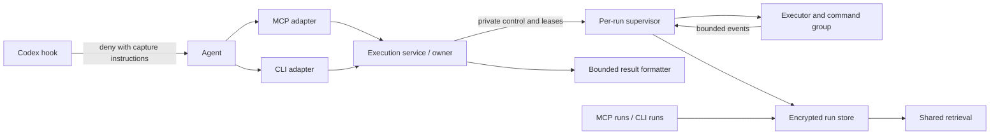

# Routine command capture and recovery

> Status: revised draft — review corrections incorporated; independent re-review pending
> Created: 2026-10-16
> Issue: [#132](https://github.com/serpro69/capy/issues/132)
> Public contracts: [contracts.md](contracts.md)
> Plan: [implementation.md](implementation.md) · Tasks: [tasks.md](tasks.md)
> Predecessor: [completed Codex hooks](../codex-hooks/design.md)
> Reviews: [first dispositions](review-resolution.md) · [readiness review and fixes](readiness-review.md)
> Source baseline: capy `3dadcbaa65f12ebe706b7cc9376b37e00855a162`; follow-up source verification at `55298c51ca6cdc6aa3fdf2382e9665a15892608f`

## 1. Problem, users and success

Routine tests, builds and dependency installs spend model context on passing
cases, progress indicators and package lists. Issue #132 demonstrated a test run
whose capy execution/search responses used 81.8% fewer bytes than processed output.
That motivates this work; it is not a measurement of the proposed implementation.

Agents and developers need bounded immediate results, trustworthy execution
status and recoverable diagnostics without repeating commands. The Codex hook
integration delivered interception/guidance but deliberately left this output
policy open. Hook registration alone does not close #132.

Success means supported routine native commands in Codex are redirected before
execution; MCP or CLI capture executes the submitted command once; responses are
bounded; and retained, completely captured output supports ordered reads and
search. Admission, command, capture, redaction and indexing failures are distinct.
Capture is required before spawn. A mid-run capture failure does not itself kill
a command that may already have changed the project.

Capture/retrieval applies to shared MCP tools and CLI on supported platforms.
Mandatory native routine routing is Codex-only in v1. Claude Code gets accurate
routine capture guidance without a new gate; its security/HTTP policies remain.
Shared generated instructions must state that distinction.

## 2. Decisions and authoritative documents

The user agreed to separate encrypted temporary storage, logs surviving session
restarts with a configurable 24-hour starting TTL and quota, shared MCP/CLI
execution, explicit capture plus targeted redirection, blocking when capture
cannot start, and continued execution with explicit incomplete capture if storage
fails after spawn. Jobs remain owner-bound; saved logs survive owner restarts.
Output bounds do not depend on intent. Capture precedes filtering.

[contracts.md](contracts.md) is the single normative definition of public fields,
state transitions, cursors, defaults, scheduling and policy changes. Numerical
limits and detailed mechanisms are design proposals, not claims that each was
separately approved in chat. The user selected inspected-source verification
rather than an additional isolated Chain-of-Verification pass.

This document owns architecture, failure guarantees and rationale. The
implementation plan names code seams and verification; tasks are commit-sized
vertical paths. Review reports retain historical findings and their dispositions.

## 3. Existing seams and upstream evidence

| Component | Integration concern |
| --- | --- |
| `internal/executor/{executor,types,safebuf}.go` | Process-group execution, separate pipe drains, early 100-KiB truncation, background output discard |
| `internal/server/tool_execute*.go`, `tool_batch.go` | Intent-gated reduction, omitted success stderr, differing deadline paths, knowledge-store writes |
| `internal/executor/exit_classify.go` | Shell exit 1 with stdout can lose explicit status/stderr |
| `internal/server/{server,lifecycle}.go` | Captured credentials, stdio/owner cancellation and shutdown |
| `internal/config/{keys,paths,loader}.go` | Credential precedence, project ownership, config snapshots and strict loading |
| `internal/sqliteutil`, `internal/retrieval` | Encrypted open/canary primitives, SQLite transactions and corpus-independent FTS |
| `internal/hook/pretooluse.go`, `internal/security/split.go` | Security-first routing, early HTTP returns and bounded shell scanning |
| `internal/platform/{setup_codex_hooks,routing}.go` | Generated matchers/instructions and committed-artifact parity |

The context-mode comparison used
[`40813fe`](https://github.com/mksglu/context-mode/tree/40813fe886798bad07c69a43d2ae00a52b4b934d).
Its src/hooks tree objects matched the gitignored local `context-mode/` checkout.
That checkout is not a submodule or a prerequisite; pinned sources suffice.

- [Results](https://github.com/mksglu/context-mode/blob/40813fe886798bad07c69a43d2ae00a52b4b934d/src/server.ts#L1879): adopt automatic reduction without intent, with a smaller complete-response budget covering all paths.
- [Capture](https://github.com/mksglu/context-mode/blob/40813fe886798bad07c69a43d2ae00a52b4b934d/src/executor.ts#L467): preserve before reducing; do not copy memory buffering, kill-on-overflow or discarded background output.
- [Routing](https://github.com/mksglu/context-mode/blob/40813fe886798bad07c69a43d2ae00a52b4b934d/hooks/core/routing.mjs#L807): do not add tail/grep before capture; that destroys diagnostics and may change status.
- [Storage](https://github.com/mksglu/context-mode/blob/40813fe886798bad07c69a43d2ae00a52b4b934d/src/server.ts#L699): retain a separate run lifecycle rather than general content storage and startup-only retention.

The [Codex hook reference](https://learn.chatgpt.com/docs/hooks#pretooluse) supports
pre-execution denial. Rewriting is host-supported but deliberately unused here;
post-tool feedback is not a lossless capture mechanism. Live acceptance records
its actual host version; previous Linux CLI 0.162.1 evidence is not validation
of this new output policy.

## 4. Architecture and dependency boundaries

Introduce `internal/execution` for shared admission, run control and result
assembly; `internal/runstore` for encrypted raw/projection/index persistence;
and a hidden per-run supervisor entry point in the same capy binary. Keep
`internal/executor` responsible for runtimes, pipes and process-group handling.
`internal/sanitize` supplies the versioned streaming redactor.

MCP and CLI use the same service and selected store; CLI never needs an MCP
server. Hooks do not open databases, resolve credentials or execute replacements.
The store depends on sqliteutil/retrieval, not server. It is not a new knowledge
source kind and does not change knowledge/vault schemas. Run-specific windows
belong in runstore, not a knowledge-store import merely to reuse its chunker.

## 5. Supervisor, cancellation and quiescence

A supervisor is mandatory for each spawned run, not an optional addition after
storage design. The current in-process guard cannot clean up after its own
SIGKILL. The execution service is the logical owner; its supervisor exists only
for that run's execution/cleanup and cannot become a persistent job daemon.

| Responsibility | Holder |
| --- | --- |
| Validate request/policies, admit metadata and reserve execution slot | MCP/CLI execution service |
| Select runtime, spawn and own command group, read pipes, sequence/redact/persist output, wait/reap | Per-run supervisor through shared executor/runstore code |
| Receive deadline/cancel/owner-liveness signals | Supervisor; owner deadline also enforced there |
| Hold owner-slot and shared lifecycle lease during any run/cleanup | Service plus deliberate supervisor-held duplicates |
| Format transport result, detach request cancellation at handoff | MCP/CLI adapter and execution service |
| Reconcile abandoned metadata | Later store users, only after cleanup leases are unheld |

Launch the same executable with a hidden supervisor mode, without an ordinary
shell wrapper. Use versioned, length-bounded private pipe messages. Pass captured
credentials through an anonymous private descriptor, never argv, diagnostics or
an on-disk manifest; do not re-resolve a different key in the helper. The admitted
run record supplies the program and validated owner/policy revision. The helper
validates the protocol, generation and inherited lease descriptors before spawn.
Ordinary executed programs inherit none of the control, credential or lease FDs.
Existing child environment behavior otherwise stays explicit and shared.

Persist an internal cleanup proof with each run: not_spawned initially, pending
before authorizing the first process creation, and retired only after every owned
process/pipe is retired. Failure to record pending prevents spawn. A supervisor
that cannot persist retired must not claim safe durable cleanup. This separates
known process retirement from the command/capture result and from a released lock.

The coordinator's liveness write end is not inherited by supervisors or commands.
EOF, explicit cancel or execution deadline makes the supervisor stop the group,
drain pipes, attempt terminal persistence, reap, close its database, then release
leases and exit. Retain the unreaped-leader protection against PID reuse. All
compilation/runtime phases belong to this lifecycle, including Rust compilation;
no compiler path may keep separate unbounded stderr or child-only cancellation.

The service holds its leases while attached to the store. A supervisor retains
references that keep the same owner-slot lock and lifecycle protection alive
even after coordinator SIGKILL. With multiple runs, the last surviving cleanup
helper releases the last inherited references. Reset/generation reuse therefore
cannot mistake coordinator death for completed process cleanup. Normal shutdown
stops admission, cancels jobs and joins supervisors before closing the service's
store/leases. No recovery operation signals a PID read from metadata.

Task 1 proves this topology with a real private helper, including owner SIGKILL,
deliberately delayed helper cleanup, concurrent reset and slot reuse. Also
exercise startup failure before/after lease transfer, broken IPC and supervisor
failure. Unexpected helper loss must be explicit interrupted/incomplete state,
not success or a claim of proven descendant quiescence. The supported OS cleanup
mechanism and any forced-process-tree-death limit must be recorded before this
risk gate passes; do not release normal reset/reuse based on an unproven cleanup
outcome. A supervisor that cannot prove group retirement must fail closed for
that generation until operator quiescence/recovery, rather than inventing success.

Request cancellation is a separate control edge. Use the atomic handler handoff
in [contracts §7](contracts.md#7-request-handoff-and-cancellation); ordinary MCP
request-context cleanup after return cannot cancel a handed-off run. Owner and
deadline cancellation remain effective. No handler can prove client receipt.

## 6. Capture and redaction

Admission checks inputs/policies, selected key, authenticated storage, policy
revision, quota and a small committed write probe before spawn. Invalid credentials
fail before directory/marker creation. After spawn, raw output is captured before
preview selection. Use bounded 16-KiB blocks, a 1-MiB queue per run and bounded
write batches. Stream/event counters and observed-order sequence numbers never
require holding a full log. Per-stream bytes/order are exact; merged order means
capy's observation order, not reconstruction across independent program buffers.

Append error, output limit or queue saturation transitions capture once to
incomplete. Preserve the committed prefix, drain subsequent output into bounded
safe diagnostics/discard, and let the command continue under normal cancellation
and deadline rules. Closing pipes or unbounded backpressure would change command
behavior. Append attempts have a bounded 250-ms deadline and no plaintext fallback.
Finalization is a separate bounded write; if it fails, expose the in-memory known
outcome with terminal_persisted=false, leaving recovery to report interrupted /
unknown status. Complete means both pipes drained and terminal state committed.

### Stateful projection

The existing whole-string StripSecrets API is insufficient for events/pages.
Keep that API for existing consumers; add a versioned per-stream recognizer that
is conservative relative to all current secret/private patterns. Every protected
span remains suppressed regardless of event/window/page partitioning; ambiguous
extra redaction is allowed. Independent stdout/stderr fragments are not joined
into a secret token.

Bound state to partial literal/tag prefixes, recognizer states/counters, raw span
positions and at most 4 KiB undecided candidate bytes per stream. Handle unbounded
values, JWT segments and key/value whitespace with state, not a fixed overlap.
On candidate overflow emit a marker and suppress until its terminator; never
release a prefix to meet a buffer limit. EOF conservatively redacts unresolved
candidates. Case-insensitive private tags may straddle events; suppress through
the first complete closing tag, retaining only its possible prefix. Nested opens
are private content; unfinished blocks remain suppressed through EOF/interruption.

Persist raw events, bounded redaction checkpoints, sanitized projection additions
and raw anchors atomically. Undecided bytes are not public data. A raw-position
request inside a protected span returns a marker; pending coverage returns no raw
text. FTS and preview/page cuts operate on the projection, never on independently
sanitized raw slices. [Contracts §5](contracts.md#5-pagination-ordering-and-coverage)
defines merged versus per-stream continuation when one projection is pending.

State/version errors fail closed for default text/search while raw capture may
remain complete. Rebuild a changed redactor version explicitly from stream start,
under bounded work; never mix versions behind an existing cursor. After storage
failure a continuous in-memory redactor may provide bounded diagnostics; lost
state means status only. Raw retrieval requires an explicit unsanitized request
and never seeds automatic previews/indexing. Bytes hidden in user code's own
subprocess buffers, or discarded by caller-added filters, are outside capture.

## 7. Store location, identity and credentials

The path is `<selected-owner>/.capy/runs/runs.db`. MCP uses its validated launch
owner. CLI implicit selection scans physical ancestors from invocation cwd; if
Codex artifacts exist, validate the entire chain and choose the nearest owner.
Malformed/ambiguous artifacts fail without Git-root fallback. With no installation,
use ordinary CLI discovery. Explicit project selection keeps the existing CLI
contract. Canonicalize the selected owner; execution cwd and knowledge store.path
never choose run storage. Nested owners/worktrees remain separate; both interfaces
for one owner share a store. A moved tree carries its local logs; historical cwd
is provenance, never an execution/signal target.

Preserve setup's `.capy/**` ignore rule and tracked `.capy/AGENTS.md`. This avoids
the home-cache write assumption for native CLI fallback. Official
[sandbox guidance](https://learn.chatgpt.com/docs/sandboxing) and
[workspace-write rules](https://learn.chatgpt.com/docs/agent-approvals-security#protected-paths-in-writable-roots)
confirm spawned commands inherit confinement. Owner-local storage still requires
that owner to be writable; a session restricted to a subdirectory may exclude an
ancestor owner. Admission names the actual path/operator remedy and never changes
stores or permissions implicitly. Only real sandboxed admission proves usability;
static doctor checks do not. Setup changes no trust or writable-root policy.

Reuse the existing selected knowledge credential resolver (ADR-032) without
opening knowledge.db. Capture one key/source per service and transfer that same
credential privately to supervisors. Preserve selected-invalid-key failure and
all precedence rules; vault credentials remain unrelated. Owned directories are
0700 and files/sidecars/locks 0600, with symlink/special-file rejection. Do not log
keys, DSNs, raw programs or raw output. No plaintext run-log spool is introduced.

### Owner registry and abandoned runs

Use 64 permanent `locks/owner-00.lock` through `owner-63.lock` files plus a permanent
lifecycle.lock and recovery.lock. Random generation IDs live in metadata, never
filenames. Every
store-holding process/helper retains shared lifecycle protection; reset takes it
exclusively. Claim a fixed owner slot exclusively and hold it through cleanup.
If all slots are occupied, return a bounded owner_slots_exhausted diagnostic.

Task 7 adds recovery.lock to serialize registry scans, owner-generation publication
and execution admission through its metadata commit. A temporary scanner-held
owner lock must never be mistaken for a live owner by another scanner/admitter.
Acquire shared lifecycle protection, then the exclusive recovery lock, then
nonblocking owner-slot locks; capture writes do not take the recovery lock.
Recovery-lock contention is context-bounded. This extra fixed lock closes the
scanner/admission race found by independent implementation review; it is never
unlinked/replaced and is preserved by reset with all other permanent locks.

On each store open and bounded periodic maintenance, scan the entire fixed slot
set nonblockingly, not merely the next slot chosen for allocation. For each free
slot, hold its exclusive lock, re-read its recorded generation and cleanup proofs,
and transactionally mark proven not-spawned/retired unfinished runs interrupted
with their recorded TTL. A stale pending proof becomes cleanup_unverified: retain
its evidence, block new execution admission for that store and require operator
quiescence plus explicit reset; do not silently expire/reuse it. A
held slot is skipped even if a coordinator PID/heartbeat looks dead: a supervisor
may be retiring its group. Never signal by stored PID, adopt jobs or resume code.
Slot allocation performs the same reconciliation before publishing a new generation.
Recovery is idempotent and scans a bounded 64 slots, so stale high-numbered slots
cannot remain active forever under later low concurrency. Failed cleanup proofs
are a distinct recovery error, not automatic interruption/reuse.

Never unlink/replace permanent locks. Generation metadata and per-run provenance
are separate so old rows cannot be mistaken for a replacement owner. Tests must
cover abrupt death, delayed helpers, slot reuse, never-reused stale slots, reset
contention and thousands of sequential owners without file growth.

### Policy, retention and lazy indexes

[Contracts §9](contracts.md#9-store-policy-authority-and-retention) defines a
store-authoritative policy revision and quiescent updates. A CLI with changed
limits cannot race a long-lived MCP owner still applying old limits. TTL is
recorded at run admission; completed expiries are immutable. Quota pressure can
evict completed runs before TTL, but active runs remain protected. Maintenance
runs on open, periodically while active and at shutdown; idle machines need no
cleanup daemon. Physical SQLite/WAL usage is reported separately from accounted
quota. Keep DB pools/transactions bounded and parameterized; no command-long
transaction. Close handles before final checkpoint and tolerate busy checkpoints
from other owners without destructive recovery.

Raw/projection capture is eager; dual FTS is lazy on explicit search, batch queries
or nonblank intent. Ordinary no-intent failures/successes create no FTS rows and
use safe head/tail previews. Index only finalized projection coverage in bounded,
resumable transactions, with a per-run claim owned by a live store generation.
Cancellation/claimant death releases or reconciles that claim under the same
owner proof; a stale claim cannot block future search indefinitely. Prefer capture
writes. Index error/quota exhaustion cannot erase raw logs or imply zero matches
in unindexed output. Account both FTS tables and posting/shadow pages as specified
in the contracts, and measure first/repeated search cost under concurrent capture.

### Rotation and reset

V1's supported run-cache recovery after knowledge-key rotation is explicit discard
and reset. There is no `capy runs rekey` command or promised preservation workflow
in this feature. `capy encrypt` still rotates only knowledge storage; its guidance
must warn before rotation that old run logs will need explicit reset after the
selected credential changes, and repeat the recovery instruction afterward.
Do not silently perform multi-database rotation or reset disposable data.

`capy runs reset --discard` needs no old key. It takes lifecycle.lock exclusively,
refuses active owners/handles/supervisors, validates the owned directory/files,
and deletes only runs.db and known SQLite sidecars (-wal, -shm, -journal). Preserve
all permanent locks, settings and unrelated capy data. Next execution creates a
new encrypted store UUID/policy under the selected key; old cursors become stale.
Wrong-key errors name the selected path, data-loss consequence and this command.
Missing/wrong keys or corruption never trigger automatic deletion or credential
fallback. The explicit discard operation also requires the operator to have
stopped the old execution groups; exclusive lock acquisition proves only that
cooperating lease holders are gone. After cleanup_unverified, show that requirement
and never invoke reset as an automatic agent retry. A coordinator's death alone
does not establish that its descendants stopped.

## 8. Routing, policy and observations

Codex evaluates whole-request security first, including parsed capture-CLI code.
Then classify all executable elements for uncaptured routines, honoring only
explicit output-policy exceptions. Any required capture denies the entire request
before an HTTP branch can allow, consume evidence or recommend native fallback.
Only requests without that requirement enter existing HTTP-only routing.
Thus curl plus make test is mandatory capture for root and child callers regardless
of evidence. The routine denial consumes no HTTP evidence; HTTP-only safe-download,
one-use and advisory behavior remains separate.

Use the bounded security shell scanner and literal argument parsing, not substring
matching. Initial catalogue: go test/build; cargo test/build/check; pytest and
literal python -m pytest; pip install and python -m pip install; npm/pnpm/yarn
install/ci/add/test/build/run forms; make/gmake targets; gradle/gradlew, mvn/mvnw,
sbt and mise run. Recognize literal assignment/env/command/shell -c wrappers and
mise exec -- <recognized command>. Exclude standalone help/version probes.
Named fixtures cover issue #132's mise chain and virtualenv Python install.
Unknown/dynamic executables, aliases and script bodies receive guidance; this
is a targeted output policy, not universal shell security enforcement.

Valid literal capy execute calls satisfy output routing only after argument and
underlying-program policy checks. Lookalikes/quoted mentions do not exempt other
commands. A captured sibling does not exempt an uncaptured routine element; scan
overflow fails closed. Denials say nothing ran, recommend MCP and identify CLI
capture as an alternative without asserting availability. Capture admission errors
stop blind retries. `[routing.routine] enabled` and `native_allow` are explicit
operator policy; exceptions never bypass security. Claude receives guidance-only
routine wording and retains its approval behavior.

The shared core retains current deny-only MCP checks; hook adapters retain host
ask behavior. CLI rejects exact matched asks with source/rule because it has no
approval UI; unmatched default ask passes. Codex unwraps capture programs so
changing interface cannot sidestep policy. Do not silently change Claude approval.

Healthy running capy_execute with a run ID and recording capture counts as HTTP
availability evidence; terminal exit-zero/complete capture also counts. Unstarted,
admitted/queued, failed, cancelled, interrupted, nonzero or incomplete-capture
responses do not. Preserve root execute-only and child execute/fetch identity,
one-use and 60-second TTL rules. Timestamp the observed response, not completion.
Late failure does not rewrite past evidence. Status/read/search/cancel and CLI
execution never create/refresh it; existing fetch/legacy parsing stays separate.

## 9. Integration, rollout and diagnostics

Migrate execute, execute-file and batch to the shared service before enabling
strict routine routing. Execute-file keeps its checked path boundary; internal
fetch subprocesses retain the fetch/cache lifecycle. New runs no longer create
execute/file/batch knowledge labels. Existing ephemeral knowledge stays available
under old selectors until its ordinary cleanup; no implicit migration/deletion.
Run search is independent of knowledge-search throttling. Batch global queries
remain explicitly labelled knowledge retrieval plus run results.

Update known-tool catalogues/counts and generated/committed matchers/instructions
together, preserving external hooks and installation IDs. capy_runs combines
read/query/cancel actions and needs conservative annotations. Reload old MCP
servers before enabling the gate; a new hook cannot prove a cached old server
supports the new envelope. Live acceptance checks schemas and retrieval. Rollback
disables routine output routing before downgrade while leaving security intact.
Stop owners before moving/removing artifacts or changing credentials/store policy.
Do not edit toolbox scripts in this feature.

Diagnostics report command/capture/index/redaction status, captured/returned bytes,
expiry, active/pending work, policy revision and accounted/physical storage. Use
bounded structured slog events without raw programs/output/keys. Doctor inspects
without creating a database and does not claim hook activation. Do not count
unseen user-filtered bytes as processed or discarded bytes as retained.

Go database guidance applies through existing database/sql, encrypted SQLite,
contexts, bounded pools and transactions; no sqlx/pgx/migrator dependency is added.
Schema SQL remains reviewed implementation work against append/read/list/expiry /
search access patterns. gRPC, distributed tracing, RUM and hosted dashboards are
not relevant to this local feature. Installed mcp-go v0.46.0 supports structured
content with custom concise fallback; unpinned Context7 main was not treated as
version proof. New external APIs require version-matched lookup before use.

## 10. Assumptions, alternatives and scope

| Assumption | Required validation |
| --- | --- |
| Supervisor ownership/lease transfer survives coordinator loss | Actual helper, delayed cleanup, owner SIGKILL, reset/reuse races, pipe and compiler cases; Task 1 must settle supported behavior |
| Bounded capture/redaction can keep up | Slow/locked/full storage, queue overflow, long tokens/blocks, exact raw hashes and bounded memory |
| Owner-local storage is usable by native CLI | Actual workspace-write CLI with home-cache writes forbidden; nested/worktree and excluded-owner cases |
| Proposed budgets support useful diagnostics | Full serialized-byte accounting, middle-of-log recovery and representative failed test/install fixtures |
| Lazy indexing is affordable | No-search/first/repeat search CPU, latency, posting/WAL bytes and capture contention; both accounting modes |
| Targeted catalogue covers issue workloads | Exact mise/pip/test forms, negative literals/heredocs and mixed HTTP/routine calls |

| Rejected alternative | Reason |
| --- | --- |
| Guidance-only change | Does not enforce adoption or repair capture/recovery |
| Automatic native rewriting | Shell, approval and host integration costs |
| Post-tool output replacement | Cannot prove complete pre-truncation capture |
| Knowledge DB with shorter TTL | Couples operational churn to durable knowledge; user rejected |
| Session-only logs | Breaks restart diagnosis; user rejected |
| MCP-only or independent CLI implementation | Loses fallback or causes divergent semantics |
| Persistent job daemon | Different operational/lifetime product; user rejected |
| Home-cache default | Not generally writable from native Codex sandbox |
| Automatic multi-cache rekey | No atomic workflow across independent project caches; explicit reset is the v1 contract |

**Not Doing:** arbitrary-shell rewriting/recognition; PTY/stdin interaction;
cross-owner cancellation; jobs surviving owners; host trust/permission mutation;
knowledge/vault migration or #8 durable retention; Claude routine enforcement;
remote upload; toolbox migration; session directive replay; run-log preservation
through key rotation; universal OS/host support. Each is outside this feature's
contract, not silently deferred implementation.

The predecessor's vault fixture isolation and historical tracking corrections
remain independent tasks. Reports may reference their current wip paths; a later
move must update inbound links as part of that move. Raw encrypted output may
contain secrets; default views use the projection and explicit raw reads are
labelled unsanitized. Complete recovery applies to retained runs with complete
capture, not expired/evicted, caller-filtered or lost-after-failure bytes.

## 11. Acceptance and readiness

- Real Codex routing denies recognized/mixed routine requests before any side
  effect, for root/child and all evidence states; captured equivalents execute
  once. Claude guidance-only scope and unrelated hooks remain correct.
- Passing/failing, stderr-only, giant-line, multibyte/binary and compiled fixtures
  preserve actual statuses/raw hashes; all response paths obey serialized bounds.
  Recover a failure beyond the old truncation boundary through both interfaces.
- Every split of protected synthetic spans, unfinished private blocks, projection
  failure and cursors within redaction remains private; raw reads stay byte-exact.
- Pre-spawn key/storage/quota rejection has no command side effects. Mid-run
  capture loss permits the final command marker while returning incomplete status.
- Handler handoff survives normal request cleanup; cancel-before/after-handoff,
  response write failure, deadline and owner loss obey the exact control contract.
  Supervisor-held leases prevent premature reset/reuse; recovery scans unused
  stale slots and never signals persisted PIDs.
- Eight batch children alongside active standalone work obey shared capacity,
  queue cutoff, cancellation and paginated aggregate recovery. Queries remain
  usable under execution exhaustion.
- Old-config MCP/new-config CLI cannot concurrently enforce different store
  policy revisions. Existing expiries are immutable; lower quotas apply under
  quiescence. Key rotation/reset has a runnable, explicit data-loss workflow.
- New output never enters knowledge/vault; normal reads need no FTS. Lazy indexing
  coverage, quota rollback and both accounting modes are tested under load.
- Actual sandboxed CLI, owner/worktree identity, generated-artifact guards,
  focused race/subprocess tests, full FTS5 suite and required quality/performance
  comparisons pass. Record actual host versions and returned bytes, not UI folding.

Task 1's bounded Linux supervisor/lease proof and Task 2's synchronous encrypted
capture/recovery are complete; see the [supervisor proof](supervisor-proof.md)
and [capture verification](task2-verification.md). Task 3 bounded capture/results
are verified in [Task 3 evidence](task3-verification.md). Task 4 projection and
paging are verified in [Task 4 evidence](task4-verification.md). Task 5 CLI and
shared retrieval are verified in [Task 5 evidence](task5-verification.md).
Task 6 handoff and owner cancellation are verified in [Task 6 evidence](task6-verification.md).
Task 7 owner-crash recovery and lease safety are verified in [Task 7 evidence](task7-verification.md).
Task 8 store-policy authority and quiescent changes are verified in [Task 8 evidence](task8-verification.md).
Task 9 quota/retention/reset and policy-change maintenance are verified in
[Task 9 evidence](task9-verification.md). Task 10 lazy sanitized search, quota
accounting and resumable recovery are verified in [Task 10 evidence](task10-verification.md).
Task 11 execute-file capture, shared lifetime and exact physical-path persistence
are verified in [Task 11 evidence](task11-verification.md).
Tasks 12–17 remain pending.
These slices do not substitute for installed acceptance or independent
design/code/spec review of the remaining feature.
