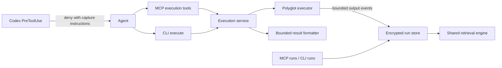

# Routine command capture and recovery

> Status: draft — direction agreed; proposed contracts and defaults await design review
> Created: 2026-10-16
> Issue: [#132](https://github.com/serpro69/capy/issues/132)
> Plan: [implementation.md](implementation.md) · Tasks: [tasks.md](tasks.md)
> Predecessor: [completed Codex hooks](../codex-hooks/design.md)
> Source baseline: capy `3dadcbaa65f12ebe706b7cc9376b37e00855a162`

## 1. Problem and intended outcome

Routine tests, builds and dependency installs can spend substantial model context
on passing tests, progress indicators and package lists. Issue #132 demonstrated
this with install logs and a test run whose capy execution/search responses used
81.8% fewer bytes than the processed output. That is evidence for the problem,
not a measured improvement for this proposed implementation.

The users are agents and developers executing project commands through capy's
MCP tools or CLI. They need bounded immediate results, trustworthy execution
status and access to the original diagnostics without repeating a command.
The framing is: how can routine execution protect context while preserving
diagnostic evidence and avoiding pollution of durable project knowledge?

The Codex hook integration delivered interception and guidance. It deliberately
left routine-output policy open. Its completion does not close #132.

Success means that supported routine native commands are redirected before they
run; either capy interface executes them once; every capy execution response is
bounded; and retained, completely captured output is recoverable through ordered
reads as well as search. Installation, capture and command failures remain
distinguishable. Capture availability is a prerequisite to starting a command.

## 2. Agreed direction and proposed detail

The conversation established these decisions:

1. One execution implementation, exposed by MCP `capy_execute` and CLI
   `capy execute`. The CLI does not call an MCP server.
2. Execution output lives in separate encrypted temporary storage, outside
   `knowledge.db` and the session vault. It is excluded from ordinary knowledge
   search. Explicitly indexing a useful finding remains possible.
3. Logs survive session restarts, with a configurable TTL starting at 24 hours,
   automatic cleanup and a storage quota.
4. Explicit capture plus targeted pre-execution redirection is preferred to
   transparent rewriting. MCP is preferred; CLI is an alternative capture path.
5. Recognized routine commands remain blocked when neither capture path works.
   Unavailable MCP must not create a loop of identical retries.
6. Capture failure before spawn prevents execution. Capture failure after spawn
   does not by itself kill the command: drain output, keep responses bounded,
   and report incomplete capture alongside the command's actual outcome.
7. Execution may outlive an MCP response but remains owned by the MCP server or
   CLI process. Logs, rather than running jobs, survive an owner restart.
8. Protection is independent of `intent`; preserve output before filtering;
   long-running execution and continued capture need explicit contracts.

The remaining API names, numerical defaults, quota semantics, recognition
catalogue and compatibility details below are **design proposals**, not claims
that each was separately approved in chat. The user chose the inspected-source
analysis instead of an additional isolated Chain-of-Verification pass.

## 3. Current implementation and upstream evidence

| Existing component | Relevant behavior / integration seam |
| --- | --- |
| `internal/executor/executor.go`, `types.go`, `safebuf.go` | Process-group execution, independently drained stdout/stderr, 30-second default, 100-KiB per-stream truncation before returning; background handoff discards subsequent output |
| `internal/server/tool_execute.go`, `tool_execute_file.go` | Intent filtering above 5,000 bytes; success omits stderr; timeout/background branches bypass intent filtering |
| `internal/executor/exit_classify.go` | Shell exit 1 plus stdout can omit explicit status and stderr |
| `internal/server/intent_search.go`, `tool_batch.go` | Execution output enters the knowledge store; reused source labels replace prior content |
| `internal/server/server.go`, `lifecycle.go` | Captured credentials, owner cancellation and shutdown; knowledge-search throttling is shared across callers |
| `internal/config/keys.go`, `paths.go` | Existing key precedence, project/knowledge-owner separation and XDG resolution |
| `internal/sqliteutil/`, `internal/retrieval/` | Encrypted open/canary/rekey primitives and corpus-independent FTS retrieval |
| `internal/hook/pretooluse.go`, `internal/security/split.go` | Security-before-routing, bounded shell scanning and existing HTTP evidence rules |
| `internal/platform/setup_codex_hooks.go`, `routing.go` | Generated matchers/instructions must stay synchronized with committed artifacts |

The upstream comparison inspected context-mode at
[`40813fe`](https://github.com/mksglu/context-mode/tree/40813fe886798bad07c69a43d2ae00a52b4b934d).
Its `src` and `hooks` Git tree objects matched this checkout's submodule, allowing
local source inspection without updating it.

- [Result handling](https://github.com/mksglu/context-mode/blob/40813fe886798bad07c69a43d2ae00a52b4b934d/src/server.ts#L1879)
  automatically reduces ordinary results above 100 KiB without `intent`. Adopt
  automatic reduction, with a smaller budget and coverage of every exit path.
- [Capture](https://github.com/mksglu/context-mode/blob/40813fe886798bad07c69a43d2ae00a52b4b934d/src/executor.ts#L467)
  avoids early 100-KiB truncation but buffers up to 100 MiB, kills on overflow,
  and discards new output after background detachment. Adopt capture-before-view;
  stream into storage and retain our agreed incomplete-capture behavior.
- [Build routing](https://github.com/mksglu/context-mode/blob/40813fe886798bad07c69a43d2ae00a52b4b934d/hooks/core/routing.mjs#L807)
  recommends `tail -30`. Do not copy it: pre-filtering destroys recovery evidence
  and may change pipeline exit status. Submit the original command.
- [Store initialization](https://github.com/mksglu/context-mode/blob/40813fe886798bad07c69a43d2ae00a52b4b934d/src/server.ts#L699)
  uses the general content store and 14-day startup cleanup. This does not meet
  the chosen isolated run lifecycle.

The [Codex hook reference](https://learn.chatgpt.com/docs/hooks#pretooluse)
supports pre-execution denial. Input rewriting is supported by the host but
deliberately unused here. Post-tool feedback replacement is not our capture
mechanism. Live acceptance must record the actual tested Codex version; the
previous feature's Linux CLI 0.162.1 evidence does not validate this new policy.

## 4. Architecture and ownership

Introduce `internal/execution` for admission, run lifecycle and result assembly,
and `internal/runstore` for encrypted run persistence and retrieval. Keep
`internal/executor` responsible for runtimes, process groups and output draining.

Hooks never open the run database, resolve keys or run a command on the caller's
behalf. Execution admission verifies the real capture path. A routine-routing
denial is a requirement to use capture, not a claim that MCP is available and
not a permission grant for its replacement.

The execution service owns active runs and their cancellation. Each MCP server
holds one service; a CLI invocation owns its service until completion. Both
interfaces open the same project run store. Read/list/search are independent of
the creating process; cancellation is addressed only to a run owned by the
receiving service. Cross-process cancellation is out of scope for v1.

The store depends on `sqliteutil` and `retrieval`, never on `server`. It is not a
new knowledge source kind. Knowledge labels, durable retention and vault schemas
are unaffected. Bounded run-specific FTS windows should be implemented locally;
do not import the knowledge store merely for its chunker.

## 5. Public execution and retrieval contracts

### Execution inputs

Retain MCP `language`, `code`, `cwd`, `timeout`, `intent` and `background`.
Add `wait_ms`, which controls response waiting rather than execution lifetime.
CLI `capy execute --language <language> --code <code>` maps to the same request;
language defaults to shell only in CLI convenience parsing. A mutually exclusive
`--code-file` reads the program before admission; it must obey file admission
rules. An argv execution variant is not required for v1.

The request's program is never silently rewritten with `tail`, `grep`, `tee`,
`2>&1`, `pipefail`, retries, or changed shell operators. The existing runtime and
sanitized environment are used consistently by both interfaces. Neither promises
to inherit interactive aliases, functions or shell state from the calling tool.
`cwd` affects execution, not project identity or storage ownership.

`timeout` remains milliseconds and becomes an exact positive execution deadline;
avoid existing integer conversion to seconds. Omitted values use the proposed
30-minute default. Explicit zero/negative/non-integral values fail validation.
The MCP default wait is 10 seconds; expiry returns `running` and the same run ID
continues capturing. The CLI waits for completion so it remains the process
owner; its host can yield/poll the CLI process using native execution facilities.
The CLI does not exit after printing a PID or silently daemonize.

Execution requests are non-idempotent. CLI fallback is safe after discovery or
admission failure only when execution is known not to have started. If an MCP
response is lost or a call reports capture failure after spawn, inspect run
status/listing before any retry; an unknown outcome is not permission to execute
again. A repeated execute request creates another run, not an implicit resume.

For migration, explicit `background: true` retains its historical meaning:
`timeout` is the initial detach/wait duration, not a kill deadline. It returns
`running`, captures subsequently, and ends on explicit cancellation or owner
shutdown. Reject `background: true` combined with `wait_ms` instead of assigning
ambiguous precedence. Describe this legacy daemon mode separately from routine
jobs, which use `wait_ms` and an execution deadline.

### Result envelope

Every admitted execution produces an opaque UUID run ID. Return a versioned
envelope containing:

| Field group | Contract |
| --- | --- |
| Identity | `version`, `run_id`, optional batch ID, redacted invocation preview, canonical execution directory |
| Execution | `state`: admitted/running/exited/timed_out/cancelled/start_failed/interrupted; nullable `exit_code` and signal; elapsed time |
| Capture | recording/complete/incomplete; captured and observed byte counts; reason; last committed cursor; whether terminal state is durably recorded |
| Retrieval | bounded preview, next-read cursor, stored expiration time, optional index error/state |

Pre-admission rejection has a null run ID and an explicit `not_started` outcome.
An incomplete run may still be executing; its result must say so even when MCP
`isError` is true, and direct the caller to status/read rather than another execute.

No inferred success from output text. Nonzero exit 1 remains 1 even with stdout.
Timeout and cancellation never become ordinary success because partial output
exists. An FTS failure does not imply raw capture failed; report index readiness
separately and retain ordered reads.

MCP uses `structuredContent` plus a concise text rendering. `isError` is true for
admission/start failure, nonzero terminal execution, timeout/cancellation or
incomplete capture. A running, healthy run is not an error. Inspect the explicit
statuses to distinguish failure classes.

CLI JSON contains the same envelope; default text presents the same facts.
Preserve a normal child exit code when it is nonzero. For command exit 0 with
capture failure, return 74; admission/usage/start failure returns 1/2/126-or-127
as applicable; timeout returns 124 and signal termination 128+signal. The envelope
always carries the actual child status, avoiding ambiguity with a child's own
exit 74/124. A successful command with failed capture cannot look successful to
shell automation. Final exit-code mapping needs explicit compatibility fixtures.

### Retrieval surface

Add MCP `capy_runs` and CLI `capy runs` with status, list, read and search actions;
MCP also accepts cancel for its own active runs. Status and listing allow recovery
when the initiating response was lost. Reading a run never re-executes it.

Read defaults to ordered captured events, with a cursor containing run ID,
sequence and byte offset. Optional stream and line selection use per-stream line
numbers; continuation within a huge/no-newline line is explicit. Raw byte reads
use bounded base64 results. Text views replace invalid UTF-8 and escape terminal
controls without altering stored bytes. Search returns line/event anchors into
the same run; run ID is mandatory for v1 search, avoiding implicit cross-run recall.

Run retrieval has an independent response bound and concurrency admission, not
the knowledge-search taper/block budget. `capy_search` is not a fallback for new
execution output. Missing/unavailable/expired runs never trigger a command retry.
Expired rows are denied at read time even if physical cleanup is pending. Once a
deleted row's metadata is gone, return `run_unavailable`; do not invent whether
it expired, was evicted or never existed.

### Response budget

Proposed default: 8,192 bytes for the fully serialized MCP tool result, including
structured content, text, escaping, metadata and errors. CLI JSON/text plus its
own stderr diagnostics obey the same per-invocation budget. Host-added banners
and transport framing are measured separately, not claimed as capy's bytes.

Formatting reserves essential status/ID/cursor fields first and allocates the
remainder to previews. Use UTF-8-safe slicing and measure serialization, not just
the source string. Small results include both streams. Large results use bounded
head/tail excerpts; `intent` or default failure terms may select indexed windows
after capture. Failure snippets are hints, not assertions that every failure was
found. Admission, database, runtime, timeout, background and oversized-line paths
all pass through the same final bound.

## 6. Capture, ordering and failure behavior

Persist append-only output events with a run-local sequence, stream, byte offset,
observation timestamp and raw bytes. One sequencer assigns arrival order across
the two pipe readers. Per-stream order and bytes are exact. Cross-stream order
means **order observed by capy**, not reconstruction of the program's wall-clock
write order across independently buffered streams. State this in retrieval help.

Use bounded read blocks (proposed 16 KiB), a bounded queue (1 MiB per run), one
ordered writer, and bounded write batches. Store neither a whole log nor all
command output in memory. Newline tracking must handle split UTF-8, huge lines,
binary data and stderr-only output. Capture includes bytes actually emitted by
the submitted process; bytes hidden inside user code's own subprocess buffers
cannot be recovered. Guidance must not suggest filtering before capture.

Admission validates inputs/policies, captures the key, opens/authenticates the
store, performs bounded maintenance, checks quota and commits initial metadata
plus a small write probe before spawning. Missing keys, wrong keys, unavailable
storage, quota exhaustion or probe failure mean no command side effects.

After spawn, an append error, capture-byte limit or queue saturation transitions
the run once to incomplete. Preserve the committed prefix, continue draining to
a bounded diagnostic tail/discard sink, and let execution finish subject to its
normal timeout/cancellation. Never close a pipe merely because storage failed:
SIGPIPE or a full pipe would alter the command's outcome. Do not claim that
subsequent discarded bytes were retained. Retry storage only within a bounded
250-ms append deadline; do not build an unbounded spool or plaintext fallback.

Terminal metadata is a separate bounded write attempt. If it fails, return the
known in-memory result with `terminal_persisted=false`; durable state remains
unfinished and recovery reports interrupted/unknown outcome. Never persist or
report `complete` before both streams are drained and the final transaction
commits. Index failure permits raw capture to continue and is separately visible.

## 7. Run lifetime and long-running work

The run context derives from the execution owner plus its execution deadline,
not the response-wait deadline. A normal wait expiry returns a running envelope
without cancelling or detaching pipe readers. An explicit request cancellation
before the running response is delivered cancels the run. After delivery, use
explicit run cancellation or owner shutdown; do not assume host turn interruption
automatically cancels an already-returned job.

Shutdown stops admitting work, cancels owned process groups, joins process waiters
and capture writers, writes final states, then closes/checkpoints the run store.
Keep the existing unreaped-group-leader protection against PID reuse. No polling
or cancellation operation signals a PID read from a stale database.

Each service instance has a random owner ID and a held OS lock for its lifetime.
Recovery marks unfinished runs interrupted only after proving the recorded owner
lock is unheld. A heartbeat timestamp alone is not proof of death. Do not adopt
or resume abandoned processes. Normal shutdown, parent loss, SIGTERM and SIGKILL
of the execution owner must have subprocess acceptance coverage. Task 1 is a
risk gate: if the current guard cannot reliably stop descendants after abrupt
owner death, add a per-run supervisor with an owner-liveness pipe before exposing
yielding execution. Such a supervisor exists only to own/drain/reap that run;
it is not a persistent job daemon. Never weaken owner-bound semantics to make
the test pass. Forced death of the entire supervisor/process tree can only
preserve committed bytes; recovery must disclose that limit.

CLI reads can inspect MCP-created runs and vice versa. Cross-process active-run
cancellation returns `different_owner` with the creating interface identified;
it must not pretend to cancel or kill by PID. Logs survive either owner's restart.

## 8. Storage, credentials and lifecycle

### Location and encryption

Default path: `$XDG_CACHE_HOME/capy/<physical-project-hash>/runs.db`, falling back
to `~/.cache/capy/...`. Resolve the physical selected project, not execution cwd
or knowledge DB path. Sibling worktrees and nested installations stay separate;
MCP and CLI selecting the same physical owner share the store. A moved project
gets a new cache namespace; old entries remain eligible for normal expiry.
No project-local or DB-repository placement is generated by setup.

Only an opened namespace is automatically maintained; abandoned namespaces after
a move require explicit cache removal or reopening. Do not scan/decrypt unrelated
projects using the current project's key.

Reuse the existing selected knowledge credential resolver and capture that key
once per service/store instance, without opening `knowledge.db`. This avoids a
third required secret while keeping files and lifecycles separate. Preserve
ADR-032 precedence and fail without fallback on invalid selected credentials.
The vault key remains unrelated. Hooks stay credential-free. Directory mode is
0700; database, sidecars and lock files are 0600. Reject unexpected symlinks and
special files in owned cache artifacts. Do not log DSNs, keys, raw commands or raw
output in diagnostics. No new plaintext log spool or secret-bearing manifest.

Changing the shared key does not silently discard old run storage. Document
quiescent rotation using the existing backup-copy rekey mechanism, or explicit
deletion of the disposable run cache after stopping all owners. Wrong-key open
is always an error. Automatic corruption recovery must not replace existing logs.

### Data model and consistency

The conceptual model contains versioned run metadata, append-only raw events,
FTS windows with event/line anchors, and owner/quota accounting. Schema SQL and
indexes are implementation work, reviewed against the listed access patterns:
append events by run/sequence, page reads, list recent project runs, select expired
terminal runs, and run-filtered Porter/trigram search. Declare a reader-version
marker and reject unsupported newer versions before mutation.

Use the repository's `database/sql` and existing encrypted driver. Parameterize
values; table names and projections are internal constants. Contexts bound all
queries/transactions. Raw append and committed-byte accounting are atomic; FTS
is derivative and may lag with an explicit high-water cursor. Use SQLite write
transactions for quota arbitration across independent CLI/MCP processes. Never
hold a transaction for an entire command. Configure a small bounded pool and
busy deadlines; close readers/rows. Pool close precedes final checkpoint, and a
busy checkpoint caused by another owner must not imply data loss or trigger
destructive recovery.

### Retention and quota proposals

TTL is measured from terminal completion, defaults to 24 hours, and is not
renewed by reads/searches. Active runs are never evicted; interrupted recovery
assigns a terminal timestamp. Cleanup runs on store admission, periodically
while an owner is active (proposed 60 seconds), and in a bounded pass on shutdown.
No daemon wakes an unused machine solely to delete logs; reads enforce expiration
and the next opening performs overdue cleanup.

Proposed limits are 64 MiB captured raw bytes per run, 512 MiB retained logical
data per project (metadata, raw bytes and FTS text counted), and four active runs
per owner. Physical SQLite/WAL allocation is measured separately: logical quota
does not promise an identical disk-byte ceiling. Checkpoint regularly and reclaim
free pages during quiescent maintenance; report physical usage in diagnostics.
Any disk-full error follows the capture-failure contract.

Under quota pressure, delete expired terminal runs first, then oldest completed
runs; never active runs. TTL is therefore a maximum retention window, not a
minimum guarantee under pressure. Report this in help and status. If active data
alone prevents admission, fail before spawn. Recheck accounting transactionally
on append; if a running command can no longer capture within quota, mark its
capture incomplete and continue draining. Configuration validates positive
integral bounds and a per-run limit no larger than the project limit.

## 9. Targeted routing and policy preservation

Add a shared routine-command classifier, initially used by Codex Bash routing.
Use `security.SplitChainedCommands` and bounded literal-token parsing; do not use
substring matching as shell parsing. Policy evaluation still precedes routing.
Source excerpts and diagnostics have their own bounds and secret redaction.

Initial recognition catalogue:

| Command families | Recognized forms |
| --- | --- |
| Go / Rust / Python | `go test/build`, `cargo test/build/check`, `pytest`, literal `python -m pytest`, `pip install`, literal `python -m pip install` |
| Node package managers | npm/pnpm/yarn test, build, install/ci/add and explicit run/run-script tasks; recognize manager-specific argument positions |
| Build/task runners | make/gmake targets, gradle/gradlew, mvn/mvnw, sbt, `mise run`; exclude standalone help/version probes |
| Literal wrappers | assignments, supported `env`/`command` wrappers, literal shell `-c`, `mise exec -- <recognized command>` |

Commands from #132 must be fixtures, including the `mise` chain and virtualenv
Python pip installation. Recognizing a qualifying element blocks the entire
native request before any element runs. Chains/pipelines are submitted unchanged
through capture, preserving their user-specified shell semantics. Do not resolve
aliases, shell functions, variable executable names or inspect arbitrary scripts
and Makefiles. Unknown forms receive bounded guidance; this is targeted output
policy, not a universal command-enforcement/security boundary.

Literal valid `capy execute` calls are recognized as already captured, after
parsing their actual arguments and inspecting underlying code for applicable
security policy. A text mention, quoted example or similarly named executable
does not exempt other elements. An uncaptured routine command after a captured
command still denies the whole native request. Scanner overflow fails closed.

The denial names the matched category, says that nothing ran, recommends MCP,
and gives CLI capture as the alternative. When capture cannot start, stop retrying
and present the capture diagnostic. Unlike existing HTTP routing, this routine
policy does not consume recent-success observations or permit a native fallback
because observations are absent. Existing HTTP/child evidence semantics stay
within their current contracts; distinguish those policies in guidance/tests.

Native live-debug/interactive exceptions are explicit operator configuration,
proposed `[routing.routine] native_allow` command patterns and an `enabled` switch.
Exceptions only skip output routing, never command/file policy. Do not provide an
agent-supplied magic argument that grants itself a security exception. An agent
requiring an exception should identify the specific command and reason to the
operator. Static registration/doctor checks do not establish hook activation.

The shared execution core preserves existing deny-only checks for MCP; hook
adapters remain responsible for host ask behavior. CLI adds full matched-ask
checking because it has no approval UI, reporting the exact source/rule. Native
Codex hooks must inspect the captured program so switching interfaces cannot
sidestep a matched ask/deny. An unmatched default ask still passes. This transport
difference is explicit; do not silently change Claude's approval contract.

## 10. Integration and compatibility

Migrate `capy_execute`, `capy_execute_file` and `capy_batch_execute` onto capture
before enabling strict routine redirection. A fallback to another execution tool
must not reintroduce knowledge writes, missing status or unbounded responses.
Execute-file retains its checked-file boundary. Internal fetch subprocesses are
not routine execution results; preserve their existing fetch/cache lifecycle.

Batch execution uses a batch ID and distinct child run IDs; admission checks
every command before spawning any. Preserve serial shared deadlines/skipped
commands and parallel per-command deadlines/input ordering. Index/search results
are scoped to that batch's runs by default. Preserve explicit `query_scope=global`
as a separate knowledge lookup plus run results with explicit provenance; it
does not promote logs into knowledge. Batch response budgeting and pagination
must include all metadata and child states, including large command counts.
Add optional `wait_ms` to execute-file and batch requests as well. A yielding
batch has a live batch ID and per-child states; its deadline rules continue to
apply after the first response. Batch status/list/read must expose skipped and
not-yet-started children, rather than representing them as successful runs.

New execution output never uses `execute:*`, `file:*` or `batch:*` knowledge
labels. Existing ephemeral rows remain readable until their existing cleanup;
do not bulk-migrate/delete them or redirect source selectors invisibly. Tool
descriptions and errors must explain that new runs are recovered with `capy_runs`.

Extend executor/run configuration through existing TOML precedence and strict
validation. Proposed keys: `[runs] ttl_hours, max_run_bytes, max_retained_bytes,
max_response_bytes, wait_ms, max_active`; `[executor] timeout` changes its default
from 30 to 1,800 seconds, preserving explicit values. Deprecate
`executor.max_output_bytes` as a capture limit: retain it only as an additional
preview bound, never as an instruction to discard recoverable bytes. Document
the result-shape, timeout-default and source-selector changes in release notes.

Validate `max_response_bytes` in 2,048–65,536 bytes so essential envelope fields
always fit; `wait_ms` in 0–30,000 (zero returns initial status without waiting);
and `max_active` in 1–8. TTL and storage limits must be positive integers with
overflow-checked conversions. The deprecated preview limit constrains optional
text only, never the essential envelope. Unknown or malformed supplied values
fail before spawn; explicit values are not silently clamped into defaults.

Update tool registries, doctor tool counts, matchers and all tests assuming ten
tools. `capy_runs` is read-only except cancel; use conservative annotations for
the combined action tool. No new PostToolUse success evidence is inferred from
run status/read calls. Update generators and committed artifacts together,
including both runtime/generated guidance paths; preserve external hooks and
the Codex installation owner ID. Activation still requires host trust/reload.

Roll out capture/retrieval first, then enable the routine gate only with the
compatible installed CLI/MCP version. Rollback disables the routine-output gate
before downgrading execution support; security rules remain active. Stop owners
before moving/removing run files or changing keys. Do not change toolbox scripts
as part of this feature.

Reload existing MCP servers before enabling the gate: a new hook binary cannot
prove that a cached server with the old `capy_execute` schema supports capture.
Mixed old/new execution contracts are unsupported; live acceptance checks the
new result schema and `capy_runs`, not just successful tool discovery.

## 11. Diagnostics and profile application

Expose command and capture status, raw/captured/returned byte counts, expiration,
index high-water, logical/physical storage usage and capture rejection reasons.
Use bounded `slog` events keyed by run ID, with no output/program/credential
contents. Existing stats gain captured/returned bytes without counting discarded
bytes as retained or pre-filtered unseen bytes as processed. Doctor describes
configured paths/limits and checks existing storage without creating a database.

The Go profile applies. Database guidance contributes bounded contexts/pools,
parameterized SQL, transactions and explicit errors. Repository conventions take
precedence over the profile's generic sqlx/pgx and external-migrator suggestions:
use existing SQLite primitives, no new database dependency. This document gives
a conceptual model rather than executable schema SQL. Observability guidance
contributes structured diagnostics and counters; HTTP metrics, distributed
tracing, RUM, dashboards and gRPC are N/A for this local CLI/MCP feature.

No dependency upgrade is proposed. Dependency-handling lookup found Context7
documentation for mcp-go only on unpinned main; installed v0.46.0 source verified
`CallToolResult.StructuredContent` and `NewToolResultStructured`. The latter
supports a custom concise fallback; avoid a helper that duplicates the entire
JSON payload into text. SQLite encryption and retrieval reuse inspected local
APIs. New external APIs must repeat version-matched lookup before use.

## 12. Assumptions and risk gates

| Assumption | Validation / consequence if false |
| --- | --- |
| A small sequenced writer can keep up with routine output without blocking children indefinitely | Stress slow/locked storage and queue overflow; incomplete capture must remain bounded and command execution must continue |
| Owner shutdown can reliably clean up yielded process groups on supported OSes | Task 1 subprocess gate, including parent loss/SIGKILL; add per-run supervision if required before shipping yielding |
| Reusing selected knowledge credentials is sufficient for both interfaces | Wrong-key, config precedence, nested owner, worktree and CLI/MCP parity fixtures; no knowledge DB creation |
| An 8-KiB result is useful for ordinary failure triage | Compare retained issue-like fixtures and recovery requests; tune proposed budget before release without weakening the hard-bound property |
| The initial command catalogue covers the issue's real workloads | Installed-host tests for exact `mise`, test and pip shapes; document unknown forms, add rules with negative fixtures |
| Logical retention quota is acceptable as the operator contract | Review help/diagnostics explicitly distinguishing payload accounting from SQLite/WAL disk allocation; a hard filesystem quota would require a separate storage design |

Raw encrypted logs may contain secrets; normal previews/search apply existing
secret stripping and raw retrieval is explicit. Output content is untrusted data,
not instructions. Recovery is complete only for retained runs whose capture is
complete. Expiry, quota eviction, explicit pre-filtering, output emitted after
capture failure, and abrupt process-tree death qualify that guarantee visibly.

## 13. Alternatives and scope

| Alternative | Benefit | Cost / decision |
| --- | --- | --- |
| Guidance-only changes | Smallest patch | Does not enforce adoption or repair capture/status/storage; rejected |
| Automatic native input rewriting | Avoids an extra agent call | Shell/approval/host compatibility costs; rejected for v1 |
| PostToolUse output replacement | Can affect native presentation | Cannot establish complete pre-truncation capture; rejected |
| Existing knowledge DB with shorter TTL | Reuses storage directly | Couples operational churn and durable data; rejected by user |
| Session-only logs | Simple lifecycle | Breaks restart diagnosis; rejected by user |
| MCP-only execution | Smaller surface | Removes the selected CLI fallback; rejected after interface discussion |
| Persistent job daemon | Jobs survive client/server exit | Different lifecycle/operations product; rejected by user |
| Independent CLI/MCP implementations | Transport-specific flexibility | Divergent status/capture/retention semantics; rejected |

**Not Doing:** automatic arbitrary-shell rewriting; arbitrary scripts/aliases
recognition; PTY/stdin interaction; cross-owner job control; jobs surviving owners;
host approval/trust mutation; changes to knowledge/vault schemas or #8 durable
retention; remote log upload; toolbox migration; session directive replay;
universal runtime/platform support. These exclusions constrain this feature,
rather than silently promising later implementation.

The predecessor's vault fixture isolation and tracking corrections are independent
follow-ups. Their concrete dispositions remain in its tasks; this feature does not
mark them completed. Lifecycle and response compatibility gaps identified above
are included in the implementation tasks, not deferred to an unspecified future.

## 14. Acceptance and release gate

1. Passing, failing, stderr-only, huge-single-line, multibyte and binary fixtures
   have bounded serialized results without `intent`; exact stored byte hashes
   match the fixture streams when capture is complete.
2. Recover a middle-of-log failure beyond the old 100-KiB truncation boundary
   through both interfaces, with ordered read anchors and no second execution.
3. Preserve exit 1, pipeline semantics, compile/start errors, timeout and signals;
   distinguish command success with incomplete capture, and FTS failure with
   complete raw capture.
4. Missing/wrong key, full quota or unwritable store prevents a side-effect marker
   before spawn. Mid-run storage/queue/quota failure permits the command's final
   marker, drains pipes and reports incomplete capture with bounded memory/output.
5. A run exceeding both the MCP response wait and the old 30-second default keeps
   capturing; status/read after completion recover its tail. Explicit timeout,
   cancel, shutdown and owner-loss tests leave no owned descendants.
6. Concurrent MCP/CLI runs get unique IDs; cleanup cannot remove active runs.
   TTL read rejection, eviction, interrupted-owner recovery and key rotation
   behavior match the documented lifecycle. Knowledge/vault remain untouched.
7. Real trusted Codex interception blocks recognized native commands before any
   side effect, allows captured equivalents, preserves denials/asks, and keeps
   blocking when MCP and CLI capture are unavailable. Unknown/exception cases
   and external hooks follow the documented boundary.
8. Generated artifact equality/idempotency, focused race checks, full FTS5 tests,
   executor/retrieval benchmarks and quality comparisons pass. Record measured
   returned bytes and retrieval completeness, not UI line folding as savings.

The [implementation plan](implementation.md) names the verification per slice.
Independent design review is required before implementation; none is claimed by
this authoring pass.
